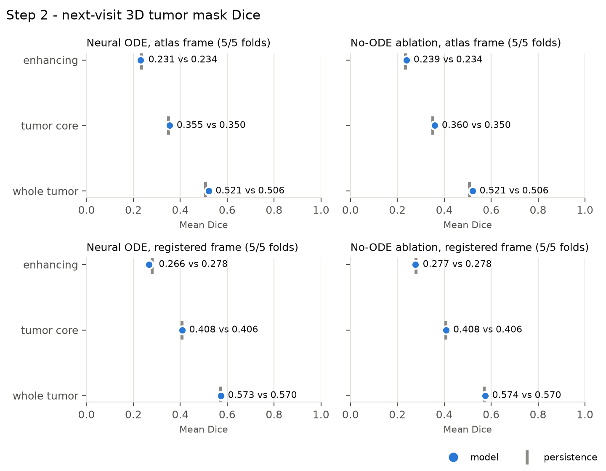
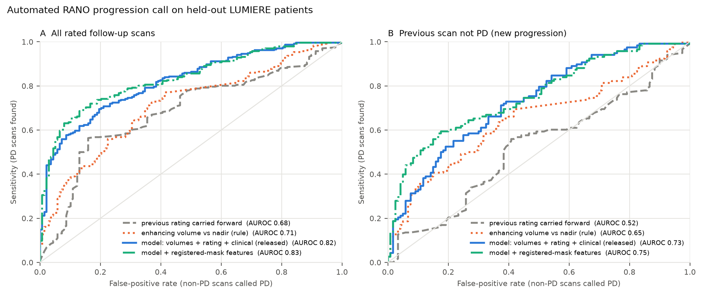
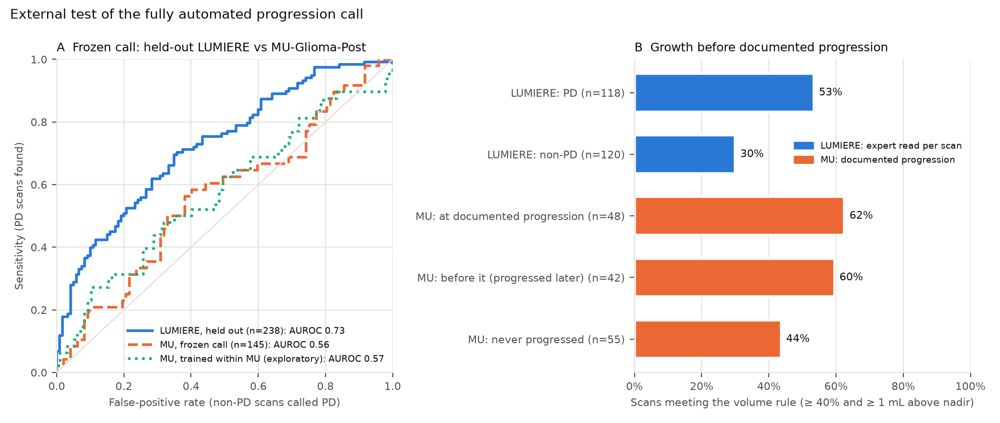
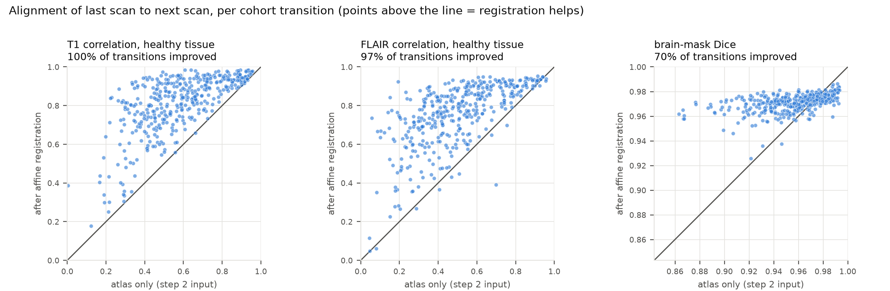
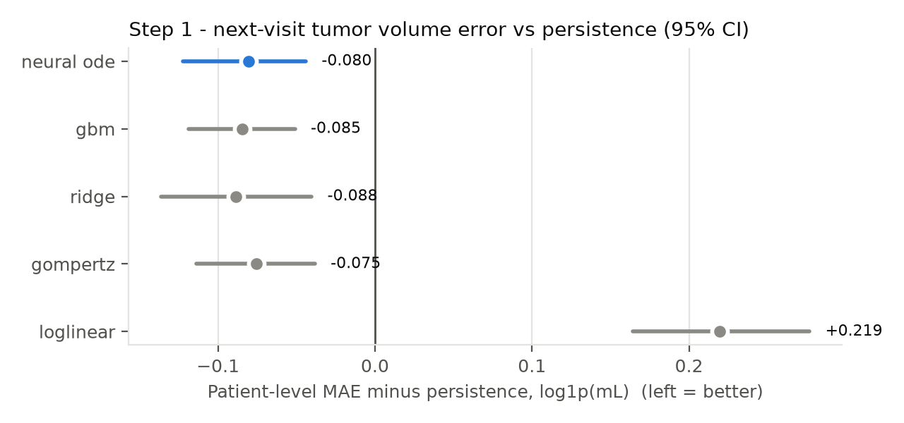
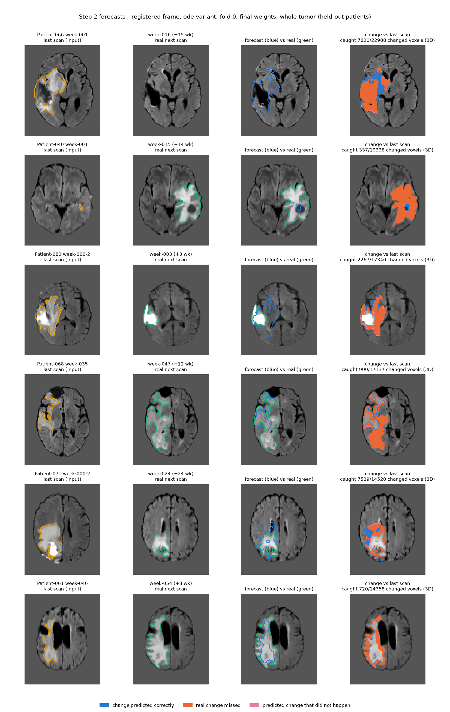
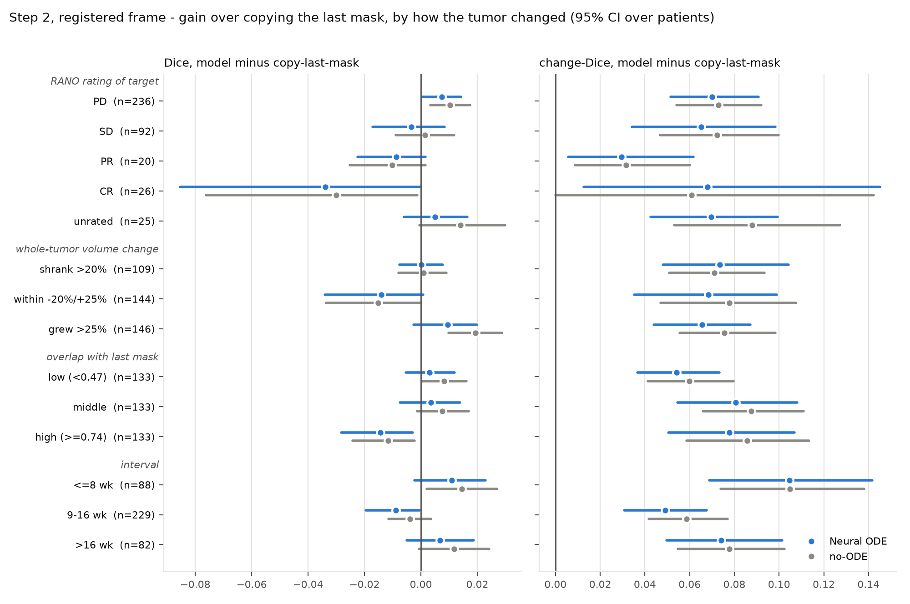
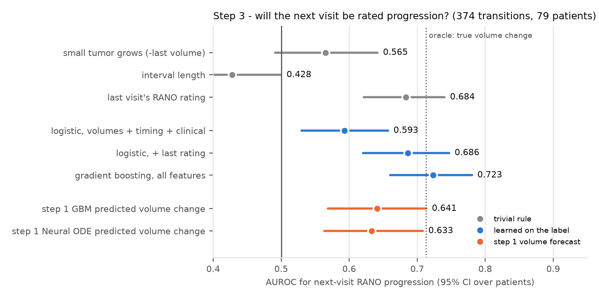
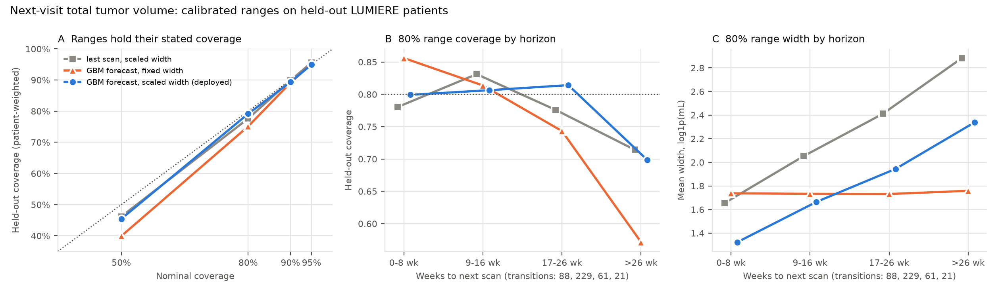
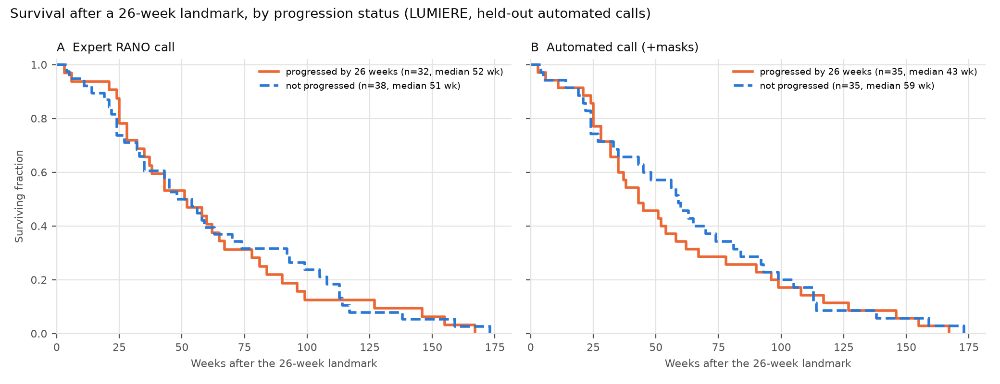

# Next-visit forecasting and automated progression assessment in glioblastoma: a leakage-free evaluation with a pre-registered external test

**Draft for submission. All numbers are reproduced by the scripts named in [EXPERIMENTS.md](EXPERIMENTS.md).**

## Abstract

**Background.** Deep models that forecast a glioblastoma's next MRI are judged against
copying the last scan; automated response assessment is a proposed alternative. We tested
both strictly on a public dataset, then tested the assessment model at a second centre.

**Methods.** LUMIERE (79 patients, 374 expert-rated follow-ups) was analysed with
patient-level cross-validation and bootstrap.
* Neural ODE forecasts of intensities, volumes, 3D tumor masks and the next RANO rating
  were compared with persistence and simple controls.
* A gradient-boosted call of progressive disease (PD) on the current scan was built from
  automated volumes. It was tested with a second segmenter, without expert input, and
  against survival.
* Under a plan fixed in advance, the frozen fully automated call was tested on
  MU-Glioma-Post (76 patients, 145 follow-ups) against clinically documented progression
  and survival.

**Results.**
* No forecast beat the best simple comparator.
  * Registered 3D masks matched copy-last (Dice 0.573 vs 0.570).
  * The last rating predicted the next as well as any model (AUROC 0.684).
* On held-out LUMIERE patients, the progression call reached AUROC 0.835 [0.796, 0.871],
  and 0.797 without expert input. It kept its accuracy with a second segmenter (0.829 vs
  0.826).
* A flag in the rating file leaked the label.
* Externally, the frozen call scored 0.563 [0.467, 0.658], against 0.725 on comparable
  LUMIERE scans.
  * A model trained within MU did no better (0.572).
  * Enhancing growth was as common before documented progression as at it.
* A volumetric rule's survival advantage over LUMIERE's expert (C-index +0.068) did not
  replicate (-0.058 [-0.161, +0.039]).

**Conclusion.** On LUMIERE, persistence is close to the best forecast, and current-scan
assessment works internally. It did not transfer: the two datasets define progression
differently, which no internal check could reveal. Automated response
assessment needs external tests against a matching reference standard. Dataset annotations
need leakage audits.

## 1. Introduction

Forecasting how a glioblastoma will look at the next visit could support response
assessment and treatment planning. Deep-learning approaches increasingly model it as a
continuous-time dynamical system [1, 2]. The tumor and the surrounding
brain change slowly relative to typical imaging intervals, so persistence (copying the last
scan) is a strong baseline. A small improvement over it can therefore come from sources
other than tumor dynamics:
* scoring on training data;
* misalignment between visits that a model learns to undo;
* the generic benefit of predicting a smoothed image under squared error;
* label noise that caps attainable accuracy.

This project began with a 2D Attention U-Net [3] + Neural ODE intensity forecaster
reported at +6.7% MSE over persistence across 81 per-patient runs. On inspection, every run
had been scored on its own training pairs. We re-tested that claim and then asked the same
question of progressively more clinically meaningful targets. Each time we included the
controls needed to read the result.

What drives change between visits is mostly treatment, which LUMIERE does not record.
Response assessment does not need that information. Whether the current scan shows
progression is visible in the current scan and its predecessors, under criteria such as
RANO [4, 5].
* Automated volumetric response assessment has been proposed before. It was reported to be
  a better surrogate for overall survival than central RANO reading [6].
* On LUMIERE itself, reproducing the expert's reading has proved hard. A deterministic
  RANO 2.0 pipeline applied to the dataset's masks agreed with the expert on 48% of
  four-class per-timepoint ratings (κ 0.17) [7]. An image-based deep network
  reached a median balanced accuracy of 51% for four-class RANO [8].

A model trained and validated on one dataset can learn that dataset's labelling habits
rather than the concept it is meant to measure. Checks inside the dataset cannot tell the
two apart. External tests with an analysis fixed in advance are therefore recommended
[9], as are audits for leakage of the label into the inputs [10].

We asked four questions:
1. Do forecasting gains survive a strict evaluation?
2. Which questions can LUMIERE answer?
3. Does an automated progression call, built for the answerable question, hold up under
   internal robustness checks, error analysis and survival analysis?
4. Does the frozen call transfer to a second centre?

## 2. Data

### 2.1 LUMIERE (development)

* **Dataset.** LUMIERE (v202211) [11]: longitudinal FLAIR, T1, T2 and contrast-enhanced T1,
  with DeepBraTumIA and HD-GLIO-AUTO [6] segmentations, expert RANO ratings [4] with a stated
  rationale, and survival times.
* **Visit resolution.** Several visits share a week number (pre-/post-operative and
  re-resection scans). We resolve these deterministically to the latest complete scan of the
  week.
* **Cohort rules** (`lumiere_cohort.py`):
  * Pre-operative scans are dropped (39).
  * A transition never crosses surgery: a post-operative scan starts a new segment, and the
    31 post-operative targets are excluded.
  * History is the earlier scans of the same segment.
* **Result:** 79 patients and 399 transitions. The exclusion log is in
  `results/volume_trajectory/metrics.md`.
* **Rated follow-ups:** 374 of the 399 targets have an expert rating of PD, SD, PR or CR
  (63% PD). In 238 of them the previous scan was not PD (50% PD).
* **Survival:** known for 86 of 91 LUMIERE patients. Of the 79 cohort patients, 76 have a
  recorded survival time. 3 of these are excluded because their recorded death precedes
  their last scan, leaving 73.

### 2.2 MU-Glioma-Post (external test)

* **Dataset.** MU-Glioma-Post [12, 13] comes from the University of
  Missouri and is distributed by TCIA under CC BY 4.0.
  * It contains post-treatment MRI of 203 glioma patients, with up to six follow-ups each.
  * The masks come from nnU-Net [14] and were refined by neuroradiologists. Their
    labels are enhancing tissue, non-enhancing core, FLAIR hyperintensity and resection
    cavity.
  * A clinical table gives days from diagnosis to each MRI, surgery, radiotherapy, first
    progression and death.
* **Reference standard.** Progression was documented from clinical notes, imaging and the
  care team's impression, by imaging, clinical findings or both. There are no per-scan RANO
  reads.
* **Cohort.** 157 patients have glioblastoma. Of these, 113 have at least two
  post-operative scans; 2 more are excluded because they progressed without a recorded day.
  76 patients contribute at least one evaluable follow-up (3.3).

### 2.3 Evaluation conventions

* **Folds.** Patient-level 5-fold assignment with seed 0, shared by all experiments. The
  volume, RANO, interval, screen, progression-call and robustness experiments add fold seeds
  1 and 2.
  Inner validation splits differ between experiments.
* **Reporting.** Differences are reported as the mean over patients of the per-patient
  difference, with 95% bootstrap CIs over patients.

## 3. Methods

### 3.1 Part 1: forecasting

Each experiment compares a Neural ODE model with persistence and simple controls on held-out
patients. Full specifications are in Supplementary S1-S2.
* **A. Intensity** (`intensity_forecast_cv.py`). The original 2D model is retested with
  patient-level CV, tumor-region MSE and a blurred-persistence control.
* **B. Volume** (`volume_trajectory_experiment.py`). The targets are next-visit log volumes
  of necrosis, enhancing tumor and edema. The methods are:
  * persistence;
  * per-patient extrapolation;
  * population Gompertz [15];
  * ridge regression;
  * gradient boosting;
  * an ODE-RNN [2].
* **C. 3D masks** (`mask_forecast_experiment.py`). A 3D U-Net with a Neural ODE or
  interval-embedding bottleneck, zero-initialised at persistence.
  * It runs in LUMIERE's atlas frame and after registering visits with SimpleITK
    [16].
  * Registration is needed because atlas-space visits are misaligned by a median 2.5 mm
    (Supplementary S1).
* **D. Segmenter agreement** (`step2_followup_analysis.py`). Same-scan agreement between
  DeepBraTumIA and HD-GLIO, and mask results by stratum.
* **E. Next RANO rating** (`rano_forecast_experiment.py`). PD at the next visit, predicted
  from information known at the last scan.
* **F. Calibrated ranges** (`volume_intervals.py`). Normalized split-conformal ranges
  [17] around the volume forecast, scored by coverage and interval score
  [18].

### 3.2 Part 2: assessment on LUMIERE

Full specifications are in Supplementary S3.
* **G. Screen** (`approach_screen.py`). Three alternative questions, each against its own
  trivial rule:
  * volume at any later scan;
  * whether the current scan is PD;
  * remaining survival from each visit.
* **H. Progression call** (`progression_call_experiment.py`; released as
  `progression_model.py`). Rows are the 374 expert-rated follow-ups; the label is PD.
  Inputs are restricted to what a reader has when the scan is taken:
  * **V**: the current scan's automated volumes, their change since the previous scan and
    since the segment nadir, and timing;
  * **R**: the previous scan's expert rating;
  * **S**: age, sex and MGMT;
  * **M**: new enhancing tumor outside the dilated prior core, and related comparisons of
    the current with the previous segmentation, in atlas space with an 8 mm margin.

  The models are gradient-boosted trees [19] with monotone constraints, so more
  growth never lowers the PD probability. "Fully automated" variants omit R and S. Two
  operating thresholds come from out-of-fold probabilities: 80% specificity ("likely PD")
  and 90% sensitivity.
* **I. Survival** (`progression_survival.py`, `volume_rule_robustness.py`). This covers 73
  patients.
  * Progression is called in one of three ways:
    * by the expert;
    * by the fully automated call (P ≥ 0.5, pre-specified);
    * by a volumetric rule: enhancing tumor ≥ 40% [5] and ≥ 1 mL above the segment
      nadir.
  * Progression enters a Cox model as a time-varying covariate. We report hazard ratios, a
    time-dependent C-index and landmark analyses.
  * The rule was rechecked with HD-GLIO volumes and over a grid of thresholds.
* **J. Robustness** (`progression_robustness.py`, `progression_learning_curve.py`).
  * *Segmenter swap.* Two-compartment models are trained on one segmenter's volumes and
    tested on the other's. Thresholds are fixed on the training source.
  * *Dependence on the expert.* The models are refitted without R, and without R and S.
  * *Learning curve.* Each fold trains on 25-100% of its training patients.
* **K. Errors** (`progression_errors.py`). Misses and false alarms of the released mask
  model are explained by four things, none of which is an input:
  * the expert's written rationale, grouped by keyword rules;
  * the next scan's rating;
  * agreement between the two segmenters;
  * time since surgery.

### 3.3 External test (L)

The scripts are `mu_freeze_model.py` and `mu_validation.py`. The plan
(`results/mu_validation/PLAN.md`) was hashed before the model was applied.
* *Model.* The fully automated two-compartment call of J, trained on all 374 LUMIERE
  follow-ups with DeepBraTumIA volumes. A copy trained on HD-GLIO volumes is secondary.
  Thresholds come from LUMIERE held-out scores on follow-ups whose previous scan was not PD.
* *Mapping.* Enhancing tumor is MU's enhancing tissue. Non-enhancing abnormality is MU's
  non-enhancing core plus FLAIR hyperintensity. The segment starts at the first surgery.
* *Labels.* The cohort is patients with glioblastoma and at least two scans.
  * The scan within 14 days of the documented first progression is PD.
  * Earlier scans, and all scans of patients without progression, are non-PD.
  * Later scans are excluded.
  * Each call needs an earlier MU scan.
* *Endpoints.*
  * Primary: AUROC. The hypothesis is that the lower 95% bound exceeds 0.5. The result is
    called consistent with LUMIERE if the interval contains LUMIERE's 0.725 for the same
    model on comparable scans.
  * Secondary: operating points, comparators, sensitivity analyses, and the 12 weeks after
    radiotherapy.
  * Survival: the censoring-aware time-dependent C-index of the volumetric rule minus that
    of documented progression, both read at MU scans.
* *Exploratory follow-up* (`mu_validation_explore.py`, written after the result). It
  examines growth before documented progression, and the same model trained within MU.

## 4. Results

### 4.1 Forecasting does not beat simple comparators (A-F)

| target | learned model | simple comparator | difference [95% CI] |
| :--- | :--- | :--- | :---: |
| intensity, tumor-region MSE (gain over persistence) | +2.5% [-1.0, +6.0] | 1-pixel blur of the last scan: +4.1% | model minus blur -1.6% [-5.1, +2.0] |
| next-visit volume, MAE in log1p(mL) | Neural ODE 0.708; gradient boosting 0.693 | population Gompertz 0.719; persistence 0.745 | ODE minus boosting +0.0040 [-0.0122, +0.0190] |
| 3D mask, registered whole-tumor Dice | Neural ODE 0.573 | copy-last-mask 0.570 | +0.003 [-0.003, +0.010] |
| next RANO rating, AUROC | gradient boosting 0.723 | last visit's rating 0.684 | +0.040 [-0.015, +0.092] |

* **Intensity.** The original whole-slice gain (+8.7% [+5.7, +11.7]) is reproduced on
  held-out patients. It vanishes in the tumor region, where a blur of the last scan does as
  well. The rest is global intensity correction outside the tumor.
* **Volume.** Volume models gain 5-7% over persistence. Much of that is mean reversion,
  which a two-parameter population model captures.
* **3D masks.** Registration alone raised copy-last-mask Dice from 0.506 to 0.570, more than
  either mask model. In the registered frame the Neural ODE matches persistence. The models
  behave like a population growth prior (Supplementary S2).
* **Next rating.** A patient rated PD is rated PD at the next visit 87% of the time. For new
  progression, every score has AUROC ≤ 0.61.
* **Ranges.** The volume model's value lies in its uncertainty. Calibrated ranges centred on
  it held their coverage (80% → 0.80), and they score 16% better than ranges around the last
  scan (interval score; CI excludes 0).

*Figure 1. Next-visit mask Dice, model vs persistence, atlas frame (top) and registered
frame (bottom).*

### 4.2 Which questions the data can answer (G)

| question | best model | its trivial rule | difference [95% CI] |
| :--- | :--- | :--- | :---: |
| volume 27-52 / > 52 weeks ahead (MAE skill vs copy-last) | GBM +14.5% / +16.4% | population Gompertz | +0.002 [-0.038, +0.040] / -0.032 [-0.108, +0.041] log1p(mL) |
| is the current scan PD? (AUROC) | 0.821 | previous rating: 0.684 | +0.137 [+0.070, +0.209] |
| remaining survival from each visit (C-index) | 0.678 | clinical + time: 0.599 | +0.078 [+0.022, +0.131] |

* **Long-horizon volume.** A two-parameter Gompertz model captures all of the gain; patient
  history adds nothing beyond mean reversion.
* **Prognosis.** This shows modest signal, partly from the rating history.
* **Current-scan assessment.** This is the only large, clean gain, so we developed it.

### 4.3 The progression call on LUMIERE (H)

| score | AUROC [95% CI] | minus previous rating [95% CI] | AUROC, previous scan not PD |
| :--- | :---: | :---: | :---: |
| previous rating carried forward | 0.684 [0.622, 0.738] | - | 0.523 |
| rule: enhancing volume change vs nadir | 0.711 [0.649, 0.772] | +0.027 [-0.059, +0.116] | 0.649 |
| rule: new enhancing volume (atlas, 8 mm) | 0.713 [0.648, 0.775] | +0.030 [-0.061, +0.117] | 0.699 |
| fully automated: volumes (V) | 0.785 [0.734, 0.835] | +0.101 [+0.030, +0.176] | 0.734 |
| fully automated: volumes + masks (V+M) | 0.797 [0.753, 0.841] | +0.113 [+0.045, +0.184] | 0.756 |
| released: volumes + rating + clinical (V+R+S) | 0.820 [0.774, 0.862] | +0.136 [+0.072, +0.203] | 0.728 |
| **released: + masks (V+R+S+M, atlas, 8 mm)** | **0.835 [0.796, 0.871]** | **+0.151 [+0.093, +0.212]** | **0.760** |
| reference: + masks (registered, 4 mm) | 0.838 [0.797, 0.873] | +0.154 [+0.093, +0.217] | 0.762 |

* **Accuracy.** The call exceeds carrying the previous rating forward by +0.151 [+0.093,
  +0.212]. For new progression it exceeds both volumetric rules: 0.760, against 0.649 and
  0.699.
* **Calibration and bands.** Its Brier score is 0.162, against 0.201 for the previous
  rating. On held-out patients, 53% of scans fall in the "likely PD" band, and 86% of those
  were rated PD.
* **A leaking annotation.** The rating file's `LessThan3Months` flag would raise AUROC to
  0.86. It is annotated selectively, mostly on early scans that had grown and that the rater
  chose not to call PD. It therefore leaks the label, and we excluded it (Supplementary S3).

*Figure 2. Held-out ROC curves of the progression call on all rated follow-ups (A) and on
scans whose previous rating was not PD (B).*

### 4.4 Robustness and errors on LUMIERE (J, K)

| train → test (two compartments, with rating and clinical factors) | AUROC [95% CI] | minus DeepBraTumIA → DeepBraTumIA [95% CI] | specificity / sensitivity at the fixed 80%-specificity threshold |
| :--- | :---: | :---: | :---: |
| DeepBraTumIA → DeepBraTumIA | 0.826 [0.779, 0.867] | - | 0.80 / 0.67 |
| DeepBraTumIA → HD-GLIO | 0.829 [0.776, 0.873] | +0.003 [-0.028, +0.035] | 0.79 / 0.69 |
| HD-GLIO → HD-GLIO | 0.815 [0.766, 0.858] | -0.011 [-0.036, +0.016] | 0.80 / 0.68 |
| HD-GLIO → DeepBraTumIA | 0.819 [0.769, 0.866] | -0.007 [-0.034, +0.021] | 0.77 / 0.71 |

* **Segmenter.** Trained on DeepBraTumIA and tested on HD-GLIO, the call kept its accuracy
  and its operating points. Yet the two segmenters' growth measurements correlate only
  0.83-0.88. The fully automated two-compartment version behaves the same: 0.797 on
  HD-GLIO inputs vs 0.785 on DeepBraTumIA.
* **Expert.** Without the previous rating, AUROC falls 0.04 overall but not for new
  progression: 0.734 vs 0.728 for volumes alone, and 0.756 vs 0.760 with masks.
* **Data.** The fully automated call with masks (V+M) stops improving at about 32 training
  patients: 0.797 at 32, 47 and 63.
* **Errors.**
  * 58 of the 64 misses are new lesions, non-measurable lesions or T2/FLAIR-only
    progression, where volumes carry little information. Measurable growth is found 93% of
    the time.
  * A third of the 28 false alarms are growth that the expert attributed to treatment.
    Another third are partial responses.
  * Details are in Supplementary S4-S5.

### 4.5 Survival on LUMIERE (I)

| progression called by | patients | median weeks start → call | median weeks call → death | HR for death after progression [95% CI] | time-dependent C-index [95% CI] | C minus expert [95% CI] |
| :--- | ---: | ---: | ---: | :---: | :---: | :---: |
| expert | 67 | 27 | 48 | 2.14 [0.80, 10.04] | 0.539 [0.484, 0.590] | - |
| volumetric rule | 67 | 23 | 45 | 3.91 [1.90, 13.10] | 0.607 [0.549, 0.662] | +0.068 [+0.008, +0.132] |
| fully automated, V+M, p ≥ 0.5 | 66 | 25 | 50 | 1.68 [0.77, 4.92] | 0.530 [0.481, 0.583] | -0.009 [-0.066, +0.050] |
| fully automated, V, p ≥ 0.5 | 67 | 25 | 49 | 2.03 [0.85, 8.60] | 0.544 [0.492, 0.599] | +0.006 [-0.038, +0.056] |

* **Automated vs expert.** The fully automated call is as prognostic as the expert's, and
  both are weak markers. The expert's C-index interval includes 0.5, and no definition
  separates survival at the 26- or 52-week landmarks.
* **The volumetric rule** was more prognostic than the expert while calling progression
  earlier.
  * The advantage held with HD-GLIO volumes, +0.058 [0.000, +0.114], and across relative
    thresholds.
  * It needed a minimum absolute growth.
  * The landmark and PFS-OS analyses did not confirm it (Supplementary S6).

### 4.6 Does the call transfer to another centre? (L)

The test set has 145 calls from 76 patients with glioblastoma: 48 PD, a rate of 0.33.

| score | AUROC [95% CI] |
| :--- | :---: |
| frozen call, trained on DeepBraTumIA volumes (primary) | 0.563 [0.467, 0.658] |
| frozen call, trained on HD-GLIO volumes | 0.586 [0.486, 0.685] |
| enhancing change vs nadir | 0.559 [0.466, 0.653] |
| enhancing change vs previous scan | 0.496 [0.408, 0.588] |
| *exploratory:* same model trained within MU | 0.572 [0.471, 0.677] |
| *exploratory:* trained within MU, plus time since radiotherapy | 0.658 [0.543, 0.765] |

* **Primary result.** The pre-specified hypothesis failed. The interval includes 0.5, and it
  excludes LUMIERE's 0.725.
* **Calibration.** The mean predicted probability was 0.69, against a PD rate of 0.33. At
  the frozen 80%-specificity threshold, specificity was 0.51 and sensitivity 0.60.
* **Not a transfer gap that retraining closes.** Trained within MU, the same features score
  0.572.
  * Enhancing growth was common before documented progression. The volumetric rule was met
    by 60% of the earlier scans of patients who progressed, against 62% of progression
    scans.
  * It was also met by 44% of the scans of patients who never progressed.
  * In MU, volumes therefore do not track documented progression. Only time since
    radiotherapy, which LUMIERE lacks, added signal.
* **Analysis choices.** No choice rescued the call:
  * imaging-documented progression only: 0.573;
  * no re-operation: 0.540;
  * progression scans on the exact day only: 0.544;
  * all glioma types: 0.580.

  The volume spreadsheet released with the data gave the same AUROC (0.563, 57 calls). It
  matched the masks exactly for 344 of 355 scans.
* **Radiotherapy window.** In the 12 weeks after radiotherapy the call was below chance:
  0.28 [0.09, 0.51], 29 calls, 5 PD. Growth there was mostly not documented as progression.
  Later scans scored 0.571.
* **Survival.** The analysis covers 99 patients and 57 deaths.
  * Documented progression was strongly prognostic: HR 7.85 [3.52, 27.91], C-index 0.671.
  * The volumetric rule scored C-index 0.613 [0.529, 0.692], close to its LUMIERE value of
    0.607. It fell below documented progression: -0.058 [-0.161, +0.039]. The pre-specified
    outcome is therefore "does not replicate".
  * The automated call scored 0.598.

*Figure 3. External test.
(A) ROC curves of the frozen fully automated call: on held-out LUMIERE follow-ups whose
previous scan was not PD, and on MU-Glioma-Post. Also shown (exploratory) is the same model
trained within MU.
(B) Share of scans meeting the volume rule (enhancing ≥ 40% and ≥ 1 mL above nadir) by
label group.*

## 5. Discussion

Within LUMIERE, the data hold enough information to read a scan's current status, but not
to forecast the next one. The external test adds a third conclusion: what the progression
call learned does not carry over to a centre whose reference standard differs.

**Why the internal checks could not catch it.** Every check in Section 4.4 changed something other
than the reference standard: the segmenter, the inputs, or the amount of training data.
Each confirmed that the call reproduces LUMIERE's reads, which follow volumetric growth
closely. MU's documented progression follows a different process:
* Growth was as common on the scans before the documented date as on the scan at it.
* A model trained within MU did no better than the frozen one.
* Only time since radiotherapy added signal.
* In the 12 weeks after radiotherapy the call was below chance. Pseudoprogression is common
  there [20], and RANO restricts calls of progression [5].

The failure therefore does not show that automated volumetric assessment cannot work
elsewhere. It shows that LUMIERE alone cannot establish it, and that a fair test needs
per-scan RANO reads and treatment dates.

**Survival.** A model trained to reproduce expert readings inherits the expert's prognostic
value, which in LUMIERE was small. The volumetric rule scored a time-dependent C-index of
about 0.61 in both datasets. What changed was the comparator: weak in LUMIERE (0.539),
strong in MU (0.671). The rule's apparent advantage in LUMIERE therefore reflected a weakly
prognostic reading, and this study does not support the rule as a survival endpoint. The
study neither confirms nor refutes the multicentre finding that automated volumetric
assessment outperforms central RANO reading [6]. It shows that such
comparisons depend on the reference.

**Forecasting.** The Neural ODE formulation does not beat the best simple comparator in any
of three settings (2D intensity, 3D mask, volume trajectory) once each confound is removed.
* *What inflated the original result.* Scoring on training pairs mattered little. Smoothing
  and global intensity correction outside the tumor explain the rest.
* *What inflated the first mask result.* Misalignment between visits.
* *Why little is left to find.*
  * Automated masks of the same scan agree only to Dice 0.65.
  * Stable visits overlap at 0.58.
  * Expert ratings are highly persistent.
  * Treatment, the main driver of change, is not recorded.

The volume model's value shows in its calibrated uncertainty, not its point forecast.

**Leakage in annotations.** The `LessThan3Months` flag looked like legitimate clinical
timing information. It was in fact recorded mostly when it changed the reader's decision.
Fields in a rating file can encode the rating, and they should be checked before use [10].

**Practical recommendations:**
1. Report persistence and a tuned blurred-persistence control.
2. Register the target into the input frame and quantify the residual misalignment.
3. Report same-scan inter-segmenter agreement without interpreting it as an accuracy bound.
   Where a dataset provides two segmentations, train on one and test on the other.
4. Report stratified results (growing, stable and responding tumors), because a growth prior
   looks like skill in pooled metrics.
5. Before forecasting, check whether the dataset supports a different, observable target.
   Screen alternatives under the same rules.
6. Audit every annotation used as an input for selective recording that correlates with the
   label.
7. Test a frozen model on external data with a plan fixed in advance. Check that the
   external reference standard matches the training labels. Internal robustness checks
   cannot substitute for this [9].

**Limitations:**
* Development used a single centre and 79 patients. The external test had 76 patients and
  145 calls. Its reference standard, clinically documented first progression, differs from
  LUMIERE's per-scan RANO reads. It therefore cannot separate a failure of the call from a
  difference in target. No temporal split is possible, because LUMIERE records weeks, not
  calendar dates.
* Labels are automated (DeepBraTumIA), apart from the RANO ratings. The progression label
  is one expert reading per scan, and inter-reader variability is not captured.
* The forecasting models are deliberately conservative (zero-initialised at persistence)
  and trained for a fixed budget. Larger models or pretraining might extract more.
* The progression call's mask margin was chosen among three on the same cross-validation.
  Its released thresholds come from out-of-fold predictions, not an independent set.
* The survival analysis assumes LUMIERE's survival times share the scan-week origin. It
  excludes 3 patients, and its landmark analyses are underpowered.
* The error analysis groups the expert's free-text rationale by keyword rules, which are
  approximate. Its subgroups are small.
* Same-segmenter test-retest data would help characterize measurement repeatability.
* The external dataset includes up to six selected scans per patient. Its labels come from
  clinical documentation, and a scan within 14 days of the documented day is taken as the
  progression scan. The radiotherapy-window and exploratory analyses are small and post hoc.

## 6. Conclusion

On LUMIERE, carrying the last scan, mask or rating forward is close to the best available
next-visit forecast. Paired comparisons do not establish ODE superiority over static
comparators.

Within LUMIERE, the same data support automated assessment of the current scan. A
volumetric progression call reaches AUROC 0.835 against the expert reading and is as
prognostic as the reading itself.
* It keeps its accuracy when the segmenter changes.
* Its skill for new progression does not depend on the expert's previous rating.
* Most of its errors trace to findings that volumes capture poorly, or to information the
  dataset does not record.

It did not transfer to a second centre: AUROC 0.563 against clinically documented
progression. A simple volumetric rule's survival advantage over the expert did not
replicate there either. The call reproduces LUMIERE's reading process. Whether automated
volumetric assessment generalizes needs external data with per-scan RANO reads and
treatment dates.

The main contribution is the evaluation protocol, its controls and the pre-specified
external test. The released models (`scripts/predict.py`; PREDICTION.md) remain research
tools.

## References

1. Chen RTQ, Rubanova Y, Bettencourt J, Duvenaud D. Neural ordinary differential equations. *Adv Neural Inf Process Syst.* 2018;31. arXiv:1806.07366.
2. Rubanova Y, Chen RTQ, Duvenaud D. Latent ODEs for irregularly-sampled time series. *Adv Neural Inf Process Syst.* 2019;32. arXiv:1907.03907.
3. Oktay O, et al. Attention U-Net: learning where to look for the pancreas. arXiv:1804.03999, 2018.
4. Wen PY, et al. Updated response assessment criteria for high-grade gliomas: Response Assessment in Neuro-Oncology Working Group. *J Clin Oncol.* 2010;28(11):1963-1972.
5. Wen PY, et al. RANO 2.0: update to the Response Assessment in Neuro-Oncology criteria for high- and low-grade gliomas in adults. *J Clin Oncol.* 2023;41(33):5187-5199.
6. Kickingereder P, et al. Automated quantitative tumour response assessment of MRI in neuro-oncology with artificial neural networks: a multicentre, retrospective study. *Lancet Oncol.* 2019;20(5):728-740.
7. Siakallis L, Bisdas S. Automated RANO 2.0-aligned response assessment for glioblastoma clinical trials: external evaluation against expert annotations. *Cancers.* 2026;18(20):3383.
8. Matoso A, et al. Towards a deep learning approach for classifying treatment response in glioblastomas. arXiv:2504.18268, 2025.
9. Collins GS, et al. TRIPOD+AI statement: updated guidance for reporting clinical prediction models that use regression or machine learning methods. *BMJ.* 2024;385:e078378.
10. Kapoor S, Narayanan A. Leakage and the reproducibility crisis in machine-learning-based science. *Patterns.* 2023;4(9):100804.
11. Suter Y, et al. The LUMIERE dataset: longitudinal glioblastoma MRI with expert RANO evaluation. *Sci Data.* 2022;9:768.
12. Mahmoud E, et al. MU-Glioma Post: a comprehensive dataset of automated MR multi-sequence segmentation and clinical features. *Sci Data.* 2025;12:1847.
13. Yaseen D, et al. University of Missouri Post-operative Glioma Dataset (MU-Glioma-Post), version 1 [data set]. The Cancer Imaging Archive; 2025. doi:10.7937/7K9K-3C83.
14. Isensee F, et al. nnU-Net: a self-configuring method for deep learning-based biomedical image segmentation. *Nat Methods.* 2021;18(2):203-211.
15. Benzekry S, et al. Classical mathematical models for description and prediction of experimental tumor growth. *PLoS Comput Biol.* 2014;10(8):e1003800.
16. Lowekamp BC, Chen DT, Ibáñez L, Blezek D. The design of SimpleITK. *Front Neuroinform.* 2013;7:45.
17. Lei J, G'Sell M, Rinaldo A, Tibshirani RJ, Wasserman L. Distribution-free predictive inference for regression. *J Am Stat Assoc.* 2018;113(523):1094-1111.
18. Gneiting T, Raftery AE. Strictly proper scoring rules, prediction, and estimation. *J Am Stat Assoc.* 2007;102(477):359-378.
19. Pedregosa F, et al. Scikit-learn: machine learning in Python. *J Mach Learn Res.* 2011;12:2825-2830.
20. Brandsma D, et al. Clinical features, mechanisms, and management of pseudoprogression in malignant gliomas. *Lancet Oncol.* 2008;9(5):453-461.

## Data and code availability

* LUMIERE is available from its authors under their data-use terms. It is not
  redistributed; see `DATA_SETUP.md`.
* MU-Glioma-Post is available from TCIA under CC BY 4.0 [13]. Only derived
  per-scan volumes are redistributed (`results/mu_validation/mask_volumes.csv`).
* All code, derived result tables and figures are in this repository. EXPERIMENTS.md gives
  every command.
* The released models run with `scripts/predict.py` (PREDICTION.md). They are research
  tools without clinical validation.

## Declarations

* **Ethics.** Both datasets are public and de-identified, and were used under their terms.
  [Confirm the target journal's and your institution's requirements.]
* **Funding.** [To be completed.]
* **Competing interests.** [To be completed.]
* **Author contributions.** [To be completed.]
* **Use of AI tools.** [Describe the use of AI assistants in the analysis and writing, as the
  target journal requires.]

---
**Status**: submission draft
**Updated**: November 17, 2026

## Supplementary material

### S1. Alignment between visits

Step 2 was first run in LUMIERE's per-scan DeepBraTumIA atlas space, on the assumption
that it makes visits voxel-aligned. We tested this assumption (`alignment_check.py`) by
correlating healthy tissue between the last scan and the target. Healthy tissue here means
the brain eroded by 2 mm, minus both tumors dilated by 5 mm.

Atlas-space alignment is poor:
* median T1 correlation 0.57;
* median estimated shift 2.5 mm (Figure S1);
* a dedicated affine registration reaches 0.85.

We therefore registered each target, and the second-to-last scan, into the frame of the
**last** scan (`register_step2_pairs.py`, 691 pairs):
* one rigid-then-affine transform per pair on T1, Mattes mutual information;
* tumors masked out of the metric;
* the transform applied to all modalities and the segmentation;
* brain-overlap QC with fallbacks.

Because the forecast is made from the last scan, the inputs carry no target information.
After registration, median healthy-tissue T1 correlation is 0.85 and brain Dice is 0.981.

*Figure S1. Alignment of the last scan to the target in healthy tissue: LUMIERE atlas space
vs affine registration, 399 transitions.*

### S2. Forecasting experiments in full

#### Methods

**A. Original intensity model, held-out retest** (`intensity_forecast_cv.py`). The
original model and metric are kept: 5 centre slices × 4 modalities, history registered to
the target, zero-initialised warp and residual heads. Only the evaluation changes:
* patient-level CV;
* the checkpoint is chosen on held-out training patients.

Controls:
* tumor-region ("focal") MSE;
* a blurred-persistence baseline, with the Gaussian width tuned on training patients only.

**B. Volume trajectory** (`volume_trajectory_experiment.py`). Targets are log1p(mL) of
necrosis, enhancing tumor and edema at the next visit. Methods:
* persistence;
* per-patient log-linear extrapolation;
* population Gompertz;
* ridge regression and gradient boosting on history features;
* an ODE-RNN (GRU updates at scans, latent ODE between them, zero-initialised residual
  decoder), as a 5-seed ensemble.

**C. 3D mask forecast** (`mask_forecast_experiment.py`).
* Input: 2 mm volumes. The last scan (4 modalities + WT/TC/ET masks), the previous scan's
  masks and gap when available, and the interval.
* Model: a 3D U-Net whose bottleneck is evolved either by a Neural ODE over the interval or
  by an additive interval embedding (ablation). It predicts a displacement field that warps
  the last mask plus residual logits. Both heads are zero-initialised, so the untrained
  model is exactly persistence.
* Selection: the checkpoint with the best validation-patient Dice over a fixed 40 epochs,
  with the persistence initialisation as a candidate. Patient folds as in B (seed 0).
* Metrics: Dice, and change-Dice (overlap of predicted and real change relative to the last
  mask).
* Frames: run in both the atlas frame and the registered frame.

**D. Inter-segmenter agreement and stratification** (`step2_followup_analysis.py`).
* (a) Same-scan agreement between DeepBraTumIA, the step-2 label, and HD-GLIO-AUTO on all
  399 target scans. HD-GLIO is mapped by registering its own CT1 to DeepBraTumIA's atlas
  CT1, with 4 starting orientations and no tumor masks used; brain-mask Dice median 0.978.
  LUMIERE's HD-GLIO native-space files are mis-oriented for many scans, so they were not
  used.
* (b) Copy-last-mask Dice on visits the expert rated stable disease.
* (c) Step 2 results split by RANO rating, volume change, overlap change and interval.

**E. Next-visit RANO rating** (`rano_forecast_experiment.py`). The task is PD vs SD/PR/CR
on 374 rated transitions. Features use only information known at the last scan:
* volume history, including height above the nadir;
* the interval;
* the last visit's rating;
* age, sex and MGMT.

Comparators:
* trivial rules: last volume, interval, last rating;
* logistic regression and gradient boosting;
* the step-B forecasts.

**F. Calibrated ranges for the volume forecast** (`volume_intervals.py`). We used
normalized split-conformal prediction [17] around the step-B gradient-boosting forecast:
* Residuals in log1p(mL) come from patient-grouped out-of-fold forecasts.
* A log-link Poisson GLM predicts residual size from the horizon, the last volume, a
  zero-volume flag and a single-scan-history flag.
* Equal-tailed conformal quantiles of the scaled residuals give the 50/80/90/95% ranges.

Evaluation is nested: the calibration is refit inside each outer training split. The
comparators are ranges centred on the last scan, with fixed or scaled width. Scoring uses
coverage and the interval score [18].

#### Results

##### The original claim on held-out patients (A)

| metric | model vs persistence [95% CI] | patients better | 1-px blurred persistence | model minus blur [95% CI] |
| :--- | :---: | ---: | :---: | :---: |
| whole-slice MSE (original metric) | +8.7% [+5.7, +11.7] | 64/79 | +3.7% | +5.0% [+2.1, +8.0] |
| tumor-region MSE | +2.5% [-1.0, +6.0] | 50/79 | +4.1% | -1.6% [-5.1, +2.0] |
| whole-slice MAE | +5.4% [+3.6, +7.2] | 64/79 | -1.2% | +6.7% [+4.8, +8.5] |

The headline number is reproduced on unseen patients. Two things show it is not tumor
forecasting:
* inside the tumor region the gain is indistinguishable from zero and below a blur of the
  last scan;
* the remaining whole-slice gain over blur is outside the tumor, consistent with global
  intensity and normalisation correction.

T1 MSE gets worse (-9.9%).

##### Volume (B)

| method | MAE, log1p(mL) | vs persistence | patient diff [95% CI] | AUROC, next-visit PD |
| :--- | ---: | ---: | :---: | ---: |
| persistence | 0.745 | - | - | 0.500 |
| log-linear extrapolation | 0.993 | -33.4% | +0.219 [+0.164, +0.277] | 0.541 |
| Gompertz (population) | 0.719 | +3.4% | -0.076 [-0.114, -0.038] | 0.584 |
| ridge | 0.721 | +3.2% | -0.088 [-0.136, -0.040] | 0.653 |
| gradient boosting | 0.693 | +6.9% | -0.085 [-0.119, -0.051] | 0.635 |
| Neural ODE (ODE-RNN) | 0.708 | +4.9% | -0.081 [-0.122, -0.044] | 0.628 |

Learned models reduce volume error significantly, but by a few percent, and much of it is
mean reversion captured by a two-parameter population model. Per-patient exponential
extrapolation is far worse than persistence. Direct paired comparisons do not establish ODE
superiority over the tabular models, or equivalence to them.

*Figure S2. Next-visit volume error relative to persistence (95% CI over patients).*

##### 3D masks (C)

| frame | variant | WT Dice, model / persistence | TC | ET | Dice diff [95% CI] | change-Dice diff [95% CI] |
| :--- | :--- | :---: | :---: | :---: | :---: | :---: |
| atlas | Neural ODE | 0.521 / 0.506 | 0.355 / 0.350 | 0.231 / 0.234 | +0.010 [+0.000, +0.019] | +0.127 [+0.107, +0.148] |
| atlas | interval embedding | 0.521 / 0.506 | 0.360 / 0.350 | 0.239 / 0.234 | +0.011 [+0.005, +0.017] | +0.118 [+0.101, +0.135] |
| registered | Neural ODE | 0.573 / 0.570 | 0.408 / 0.406 | 0.266 / 0.278 | +0.003 [-0.003, +0.010] | +0.071 [+0.053, +0.092] |
| registered | interval embedding | 0.574 / 0.570 | 0.408 / 0.406 | 0.277 / 0.278 | +0.006 [+0.001, +0.012] | +0.076 [+0.058, +0.093] |

Registration alone raises persistence Dice more than either model does: 0.506 → 0.570.
The change-Dice gain is smaller after registration. But registration changes both the
trained models and the references, so this cannot identify a causal fraction due to
misalignment. In the registered frame:
* the Neural ODE matches persistence on whole tumor and is slightly below it on enhancing
  tumor;
* validation checkpoint selection kept persistence in folds 0 and 4 for both variants;
* direct paired mean-Dice comparisons do not establish an ODE advantage; secondary
  endpoints differ.

*Figure S3. Registered-frame forecasts for held-out patients. These are fold 0 last-epoch
weights, which show what the network learned; the validation-selected fold-0 model used
for the metrics is persistence. Panels: last scan with its outline, real next scan,
forecast vs real outline, and change map.*

##### Inter-segmenter agreement and where the mask model helps (D)

| comparison | whole-tumor Dice |
| :--- | :---: |
| DeepBraTumIA vs HD-GLIO on the same scan (patient mean [95% CI]) | 0.648 [0.612, 0.680] |
| same, excluding DeepBraTumIA's necrosis/cavity label | 0.689 [0.655, 0.721] |
| copy-last-mask, visits rated stable, ≤ 12 weeks apart (mean, n=32) | 0.581 |
| copy-last-mask, all transitions (mean) | 0.570 |

Same-scan inter-segmenter agreement is not a forecasting accuracy bound. Label
conventions, correlated errors, real interval change and registration differences
prevent converting the gap above persistence into attainable headroom. Stable-visit
differences cannot all be attributed to measurement noise.

Stratified (Figure S4), the mask models behave like a population growth prior:
* They enlarge the tumor in 78-82% of transitions where the forecast differs from the last
  mask; 53% actually grew. This includes tumors that later shrank by more than 20%.
* They gain slightly where tumors grew (+0.009 to +0.019 Dice) and lose where nothing
  changed (-0.014) and under complete response (-0.03).
* Their correlation with the true volume change (+0.38 to +0.46) is matched by the last
  volume alone ("small tumors grow"; +0.47 to +0.48). After removing it, the correlation
  is +0.08 to +0.11.

*Figure S4. Registered-frame gain over copy-last-mask by RANO rating, volume change, overlap
with the last mask, and interval.*

##### Next-visit RANO rating (E)

| score | AUROC [95% CI] | minus last-rating rule [95% CI] |
| :--- | :---: | :---: |
| last volume ("small tumor grows") | 0.565 [0.491, 0.642] | -0.118 [-0.207, -0.026] |
| last visit's rating | 0.684 [0.621, 0.740] | - |
| logistic, volumes + timing + clinical | 0.593 [0.530, 0.657] | -0.090 [-0.158, -0.020] |
| logistic, all features | 0.686 [0.620, 0.747] | +0.002 [-0.042, +0.053] |
| gradient boosting, all features | 0.723 [0.660, 0.781] | +0.040 [-0.015, +0.092] |
| step 1 Neural ODE, predicted volume change | 0.633 [0.563, 0.708] | -0.051 [-0.133, +0.037] |

A patient rated PD is rated PD at the next visit 87% of the time. That rule is as strong as
any learned model, and as well calibrated: Brier 0.201 vs 0.204 for gradient boosting, and
0.233 for always predicting the base rate.

The clinically useful case is predicting new progression in a patient currently not
progressing (238 transitions, 50% PD). There, every score has AUROC ≤ 0.61 and none is
distinguishable from the last-volume rule.

*Figure S5. AUROC for next-visit RANO progression: trivial rules, models trained on the
label, and step 1 volume forecasts.*

##### Calibrated ranges for the volume forecast (F)

Held-out results for total tumor volume at the 80% level:

| range | coverage | patient-averaged coverage [95% CI] | mean width, log1p(mL) | interval score |
| :--- | ---: | :---: | ---: | ---: |
| last scan, fixed width | 0.802 | 0.757 [0.690, 0.819] | 2.067 | 3.561 |
| last scan, scaled width | 0.805 | 0.776 [0.722, 0.828] | 2.064 | 3.370 |
| GBM forecast, fixed width | 0.799 | 0.751 [0.687, 0.811] | 1.735 | 3.069 |
| **GBM forecast, scaled width** | **0.800** | **0.791 [0.739, 0.839]** | **1.668** | **2.916** |

* **Coverage.** The deployed ranges held their stated coverage: 80% → 0.80, 90% → 0.89,
  95% → 0.95. The 50% range held 0.52 of visits but 0.45 averaged over patients.
* **Sharpness.** Centred on the model, the ranges score 16% better than equally calibrated
  ranges around the last scan (CI excludes 0) and are 19% narrower at 80%. This is the
  clearest evidence that the volume model adds information, and it is larger than its 5-7%
  point-error gain.
* **Scaled vs fixed width.** Scaling leaves average sharpness unchanged but keeps coverage
  across subgroups. With a fixed width, 80% ranges covered 64% of single-scan histories and
  57% of horizons beyond 26 weeks; scaled, they covered 79% and 70%.
* **Width.** The ranges are wide: a typical 80% range spans ×0.53 to ×2.1 of the forecast.
* **Direction calls.** When an 80% range excluded "no change" (about 7% of visits), the
  tumor moved in the called direction 84% (growth) and 93% (shrinkage) of the time. The base
  rates are 55% and 44%.

*Figure S6. Held-out coverage of the volume ranges against nominal (A), and 80% coverage
(B) and width (C) by horizon.*

#### Paired effects (release audit, 2026-11-03)

See RELEASE_AUDIT.md and results/release_audit/effects.md for direct paired effects.
ODE-minus-ridge volume MAE is +0.0079 log1p(mL) (95% CI -0.0137 to +0.0290),
and ODE-minus-GBM is +0.0040 (-0.0122 to +0.0190). Mean mask Dice differences
versus static are -0.0019 (-0.0078 to +0.0041) atlas and -0.0031
(-0.0080 to +0.0013) registered. Neither superiority nor equivalence is established.
The volume experiment has three outer assignments; masks match repeat 0 only;
inner validation splits differ. No matched neural no-ODE volume model exists.
All 798 cached reference checks match, but four CPU checkpoint replays differ
slightly from historical tables. Historical volume estimator states are missing.
New all-cohort GBM weights are a refit, with no held-out estimate for those weights;
mask release ensembles combine existing CV models and have no independent ensemble
accuracy estimate. These are research artifacts, without clinical validation.

### S3. Assessment methods and progression-call details

**G. Screen of alternative questions** (`approach_screen.py`). Three tasks, each against
its own trivial rule and under the fold rules of Section 2.3:
1. volume at *any* later scan of the segment (1,473 pairs), scored by horizon, against
   copy-last, a horizon-only drift model and population Gompertz;
2. whether the current scan is PD;
3. remaining survival from each visit (73 patients, 454 visits), scored by C-index over
   pairs of visits from different patients. The comparator uses age, sex, MGMT, time since
   the first scan and the number of surgeries.

**H. Automated progression call** (`progression_call_experiment.py`; released as
`progression_model.py`). Rows are the 374 expert-rated follow-ups; the label is PD. Inputs
are restricted to what a reader has when the scan is taken:
* **V**: the current scan's automated volumes, their change since the previous scan and
  since the segment nadir, and timing;
* **R**: the previous scan's expert rating;
* **S**: age, sex and MGMT;
* **M**: comparison of the current with the previous segmentation. It measures new
  enhancing tumor outside the dilated prior tumor core, new FLAIR abnormality, new
  enhancing components and the largest axial enhancing area, a stand-in for RANO's 2D
  measurement.
  * The released version works directly in atlas space with an 8 mm margin, which absorbs
    the ~2.5 mm misalignment (S1), so no registration is needed. We chose 8 mm among
    4/6/8 mm.
  * A registered-frame version with a 4 mm margin is the reference.

The models are gradient-boosted trees with monotone constraints, so more growth or more new
tumor never lowers the PD probability. "Fully automated" variants omit R and S.
Comparators: the previous rating carried forward; enhancing-volume change since the nadir;
new enhancing volume. Two operating thresholds come from out-of-fold probabilities: 80%
specificity ("likely PD") and 90% sensitivity (below it, "PD less likely").

**I. Survival validation** (`progression_survival.py`). This covers the 73 patients with
usable survival. Progression is the first follow-up of the first surgery-free segment
called PD, made in one of three ways:
* by the expert;
* by the fully automated call, using the held-out probability with a threshold of 0.5
  (pre-specified) or one matched to the expert's number of progressions;
* by a volumetric rule: enhancing tumor ≥ 40% above the segment nadir and ≥ 1 mL above it.

A re-operation counts as progression if none was called before. Progression enters a
Breslow Cox model as a time-varying covariate. We also report a time-dependent C-index,
landmark analyses at 26 and 52 weeks, and 2,000 patient-bootstrap resamples. Survival is
never used for model fitting.

The volumetric rule was then checked in three ways (`volume_rule_robustness.py`):
* recomputed from HD-GLIO volumes;
* recomputed over a grid of relative (25-100%) and absolute (0-2 mL) thresholds;
* compared with the expert on a second measure of surrogacy, the patient-level Spearman
  correlation between progression-free and overall survival.

**J. Robustness** (`progression_robustness.py`). Same rows, folds and bootstrap as H.
* *Segmenter swap.* LUMIERE provides a second automatic segmentation of every scan,
  HD-GLIO-AUTO.
  * HD-GLIO has no necrosis label, so these models use two compartments: enhancing tumor,
    and non-enhancing abnormality (DeepBraTumIA necrosis plus edema).
  * Both segmenters' volumes are counted on each scan's native contrast-enhanced T1 grid.
    DeepBraTumIA's atlas-space volumes are also used, to separate a change of measurement
    space from a change of segmenter.
  * A model is trained on one source and tested on another for the held-out patients. Its
    thresholds are fixed on the training source's held-out scores.
* *Dependence on the expert.* The released models are refitted without R, and without R
  and S.
* *Learning curve* (`progression_learning_curve.py`). Each outer fold trains on a random 25,
  50, 75 or 100% of its training patients, with 10 subsets per fraction, and is scored on
  the whole held-out fold.

**K. Error analysis** (`progression_errors.py`). Misses and false alarms are defined by the
released mask model's held-out probabilities at the "likely PD" threshold. They are
explained by four things:
* the expert's written rationale, grouped by keyword rules:
  * for PD: measurable lesion growth, new lesion, non-measurable or non-target lesion, or
    T2/FLAIR-only progression;
  * for non-PD: whether the expert attributed growth to treatment, meaning within three
    months of radiotherapy or within the irradiated field;
* the rating of the next scan;
* agreement between the two segmenters;
* time since surgery.

Neither the rationale nor the next scan is ever an input.

#### Progression call: further results

* **Accuracy.** The call substantially exceeds carrying the previous rating forward, and
  for new progression it exceeds the volumetric rules.
  * The mask features add +0.015 [-0.002, +0.032] overall. At 80% specificity they find 73%
    of PD scans rather than 69%, and the gain is concentrated in new progression (0.760 vs
    0.728).
  * Atlas-space masks lose almost nothing against registration (0.835 vs 0.838). The 8 mm
    margin was chosen among three, so the atlas figure carries a little selection
    optimism.
* **Calibration.** Brier scores are 0.162 with masks and 0.168 without, against 0.201 for
  the previous rating and 0.233 for a constant. Monotone constraints cost nothing:
  unconstrained V+R+S scores 0.821.
* **Bands.** On held-out patients, with masks:
  * "likely PD": 53% of scans, 86% of them rated PD;
  * "uncertain": 26%, 41% PD;
  * "PD less likely": 20%, 32% PD.
* **What is missed.** PD called for T2 progression alone (18 scans) is mostly missed: 39%
  are found. Near-stable scans after a non-PD rating are over-called: across 28 scans, 25%
  were rated PD, but the mean probability is 0.44 with masks (0.48 without). Two of them
  cross the "likely PD" threshold with masks, none without. Supplementary S5 analyses every
  error.
* **An annotation that leaks the label.** The rating file's `LessThan3Months` flag marks
  scans within three months of radiotherapy, where RANO does not allow a PD call on
  enhancement growth alone. Adding it raised AUROC to 0.86. But it is annotated
  selectively:
  * of 78 rated first follow-ups 9-26 weeks after surgery, only 16 carry it;
  * flagged scans had grown (median enhancing log-change vs nadir +0.48) and unflagged
    early scans had not (-0.03).
  The flag records the rater's decision not to call growth PD, so we excluded it.

### S4. Robustness

* **Segmenter.** The model trained on DeepBraTumIA kept its accuracy on HD-GLIO inputs.
  * The two segmenters measure growth differently: correlation 0.83-0.88 for the change
    features and 0.92 for enhancing volume.
  * The fixed thresholds kept their operating points.
  * The fully automated two-compartment version behaves the same: 0.797 on HD-GLIO inputs vs
    0.785 on DeepBraTumIA.
  * Thresholds set on HD-GLIO were slightly permissive on DeepBraTumIA inputs: specificity
    0.77, and 0.74 for volumes only.
  * Measuring in atlas space or on the native grid changed AUROC by at most 0.003.
  * Merging necrosis into the non-enhancing compartment costs nothing. On the same rows the
    released three-compartment model scores 0.820.
* **Expert.** Removing the previous rating lowers AUROC overall but not for new
  progression:

| inputs | AUROC | minus released [95% CI] | AUROC, previous scan not PD | minus released [95% CI] |
| :--- | :---: | :---: | :---: | :---: |
| V+R+S (released) | 0.820 | - | 0.728 | - |
| V+S | 0.779 | -0.041 [-0.060, -0.022] | 0.725 | -0.003 [-0.019, +0.014] |
| V | 0.785 | -0.035 [-0.050, -0.019] | 0.734 | +0.006 [-0.009, +0.022] |
| V+R+S+M (released) | 0.835 | - | 0.760 | - |
| V+M | 0.797 | -0.038 [-0.054, -0.020] | 0.756 | -0.004 [-0.017, +0.013] |

  Each model is compared with the released model of its own input family, with or without
  masks. The rating helps only to recognise that an existing progression persists.
* **More patients.** Held-out AUROC with 16, 32, 47 and 63 training patients per fold:

| model | 16 | 32 | 47 | 63 |
| :--- | :---: | :---: | :---: | :---: |
| released: V+R+S+M | 0.781 | 0.816 | 0.828 | 0.835 |
| fully automated: V+M | 0.772 | 0.797 | 0.797 | 0.797 |

  The fully automated call is flat from 32 patients on, so more scans of the same kind
  will not raise it. The released model still gains about 0.007 per 16 more patients.

### S5. Error analysis

At the "likely PD" threshold, the released mask model made 172 hits, 64 misses, 28 false
alarms and 110 correct non-PD calls on held-out patients.

| expert's reason for PD | PD scans | misses | found | median enhancing log-change vs nadir |
| :--- | ---: | ---: | ---: | ---: |
| measurable lesion growth | 83 | 6 | 93% | +1.84 |
| new lesion | 80 | 24 | 70% | +0.48 |
| non-measurable or non-target lesion | 54 | 23 | 57% | +0.24 |
| T2/FLAIR progression only | 18 | 11 | 39% | -0.07 |

| expert's reason for not calling PD | non-PD scans | false alarms |
| :--- | ---: | ---: |
| growth attributed to treatment (< 3 months, or within the irradiated field) | 34 | 10 (29%) |
| another rationale | 15 | 9 (60%) |
| no rationale written | 89 | 9 (10%) |

* **Misses.** 58 of the 64 misses fall where volumes carry little information:
  * new lesions (24), which are often small (median 0.3 mL of new enhancing tumor);
  * non-measurable or non-target lesions (23);
  * T2/FLAIR-only progression (11), where the enhancing volume did not grow.

  Measurable growth is found 93% of the time.
* **False alarms: growth attributed to treatment.** A third are growth the expert saw and
  attributed to treatment, so RANO does not count it as progression. Applying that rule
  needs radiotherapy dates and fields, which LUMIERE does not record.
  * Most such scans progressed anyway: 24 of 30 with a known next scan were rated PD or
    re-operated at the next visit.
  * The call did not separate these cases: 6 of 9 called vs 18 of 21 not called.
* **False alarms: partial responses.** Another third are scans rated PR, a rating with only
  20 scans in the cohort. Five follow a PD rating. In all five the enhancing volume fell
  25-95% since that scan, yet the call was PD, with or without the previous rating as an
  input.
* **The call is not systematically early.** After a false alarm, the next scan was PD or a
  re-operation in 52% of cases, against 49% after a correct non-PD call.
* **Context.** Accuracy is lower in the first 26 weeks after surgery: AUROC 0.762 at 0-13
  weeks and 0.795 at 14-26 weeks, against 0.840 later. The intervals overlap.
* **Segmentation quality.** It is a minor factor. Where the two segmenters agree most on
  enhancing change, AUROC is 0.848; where they agree least, 0.831. The error rate rises
  from 21% to 28%.
* **Spread.** The 92 errors are spread over 55 of 79 patients.

### S6. Survival

* **Automated vs expert.** The fully automated call is as prognostic as the expert's.
  Rate-matched thresholds give the same result (C-index 0.522 and 0.541).
* **Timing.** The calls coincide in timing. Of 65 patients who progressed under both, 34
  were called on the same scan, 16 earlier and 15 later (median difference 0 weeks).
  Progression status at 26 weeks agreed for 79% of patients (kappa 0.57).
* **Both are weak markers.** The expert's C-index CI includes 0.5. No definition separates
  survival significantly at the 26- or 52-week landmarks (70 and 53 patients alive; HRs
  1.06-1.82, all CIs include 1). Nearly every patient progresses (67 of 73), so "has
  progressed" says little about who dies sooner (Figure S7).
* **The volumetric rule.** It is more prognostic than the expert while calling progression
  *earlier* (median 23 vs 27 weeks after the segment start). So its higher HR is not an
  artifact of late calls. It is one of several comparisons and its lower bound is near 0.
* **How robust the rule's advantage is.**
  * *Segmenter.* With HD-GLIO volumes the rule scores C-index 0.597, +0.058 [0.000,
    +0.114] over the expert. The two segmenters' rules call progression on the same scan in
    53 of 64 patients.
  * *Thresholds.* Any relative threshold from 25% to 65% above the nadir gives +0.063 to
    +0.069. The absolute floor is what matters: without a minimum growth in mL the advantage
    disappears (+0.008; -0.015 with HD-GLIO). The signal is, in effect, "at least about
    0.5-2 mL of new enhancing growth above the nadir."
  * *Other measures.* The patient-level correlation between progression-free and overall
    survival points the same way, 0.31 vs 0.21, but the difference is +0.099 [-0.123,
    +0.315]. The landmark analyses show no advantage.

  The advantage is consistent, but only one of three measures shows it significantly. It
  did not replicate on external data (Section 4.6).

*Figure S7. Survival after a 26-week landmark by progression status: expert call (A) and
fully automated call (B).*
