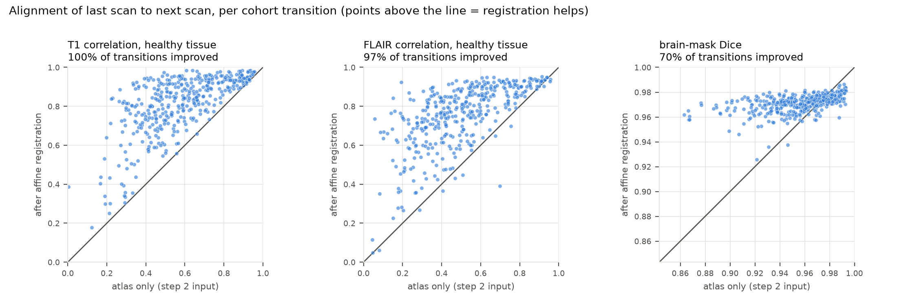
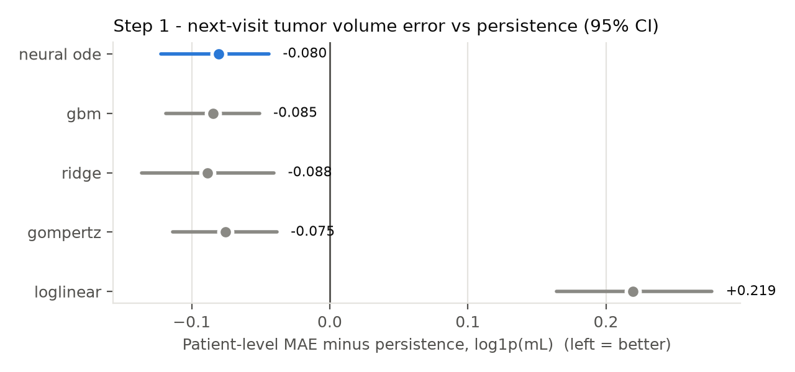
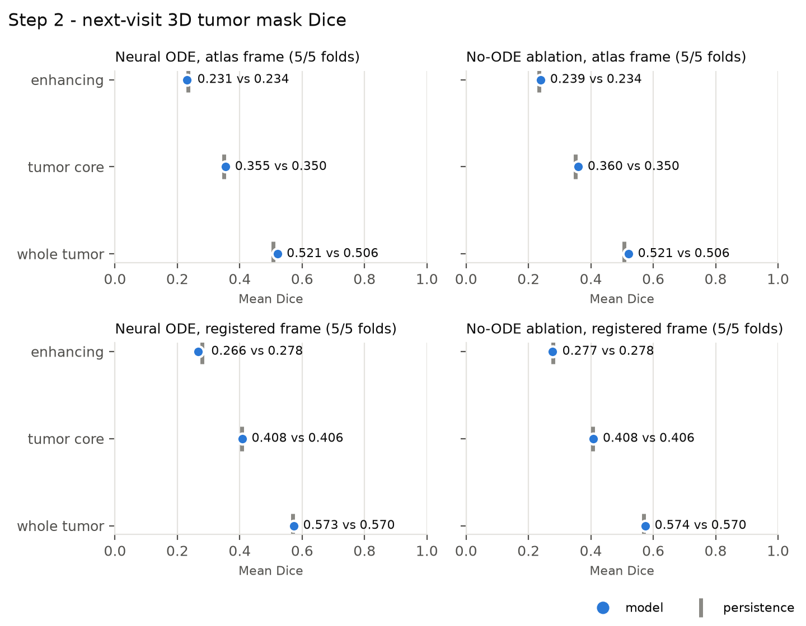
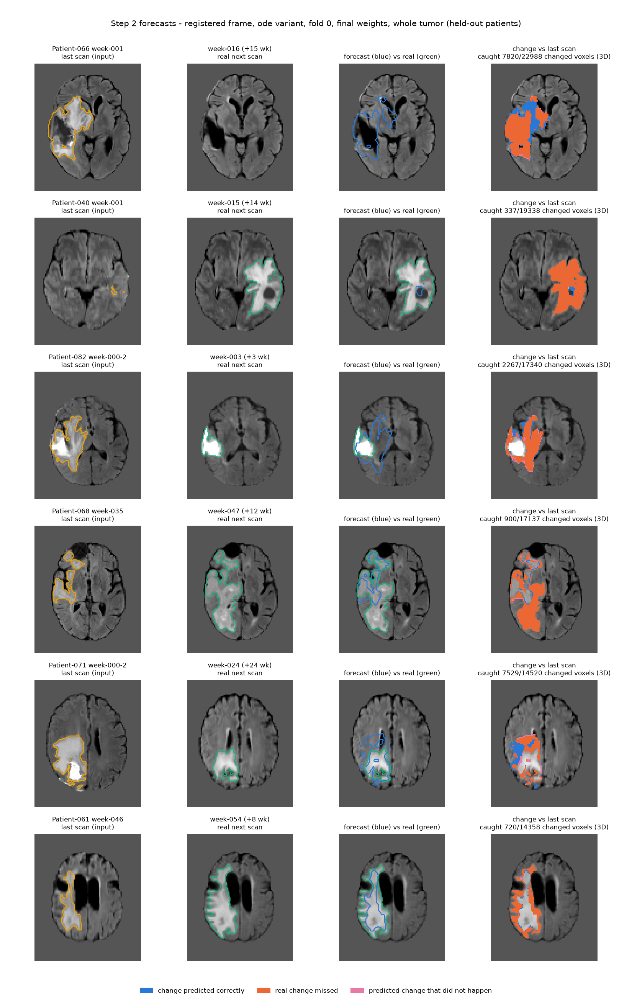
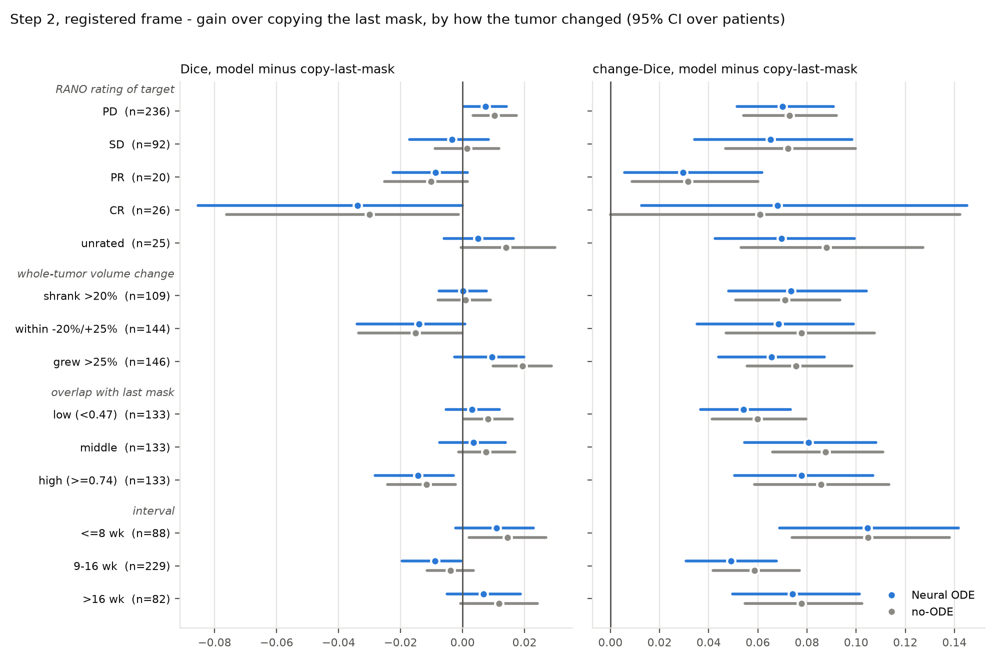
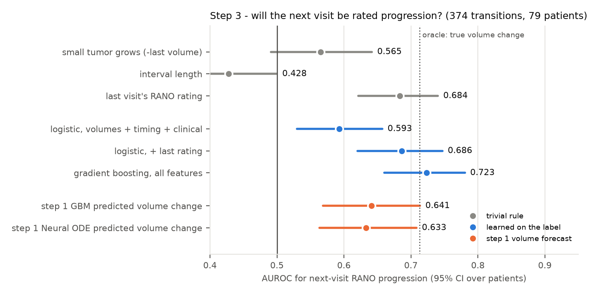
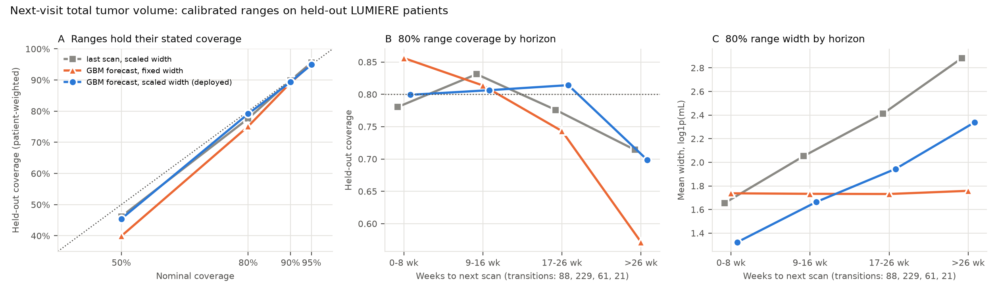
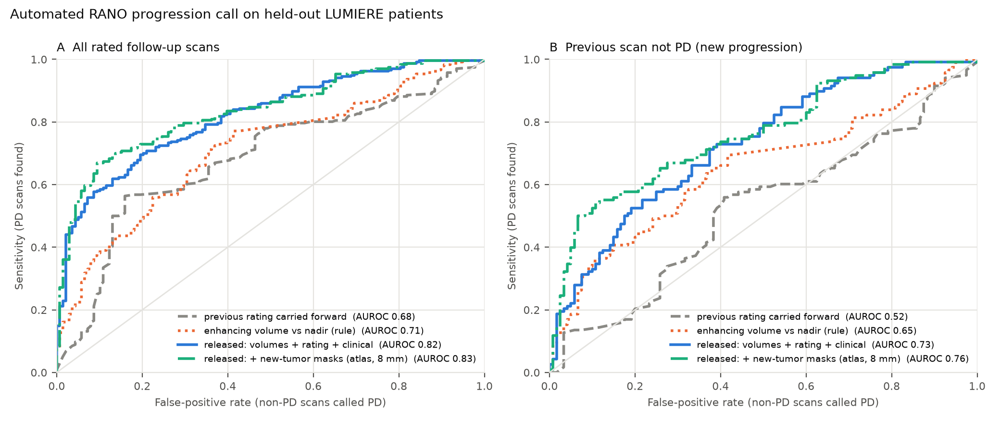
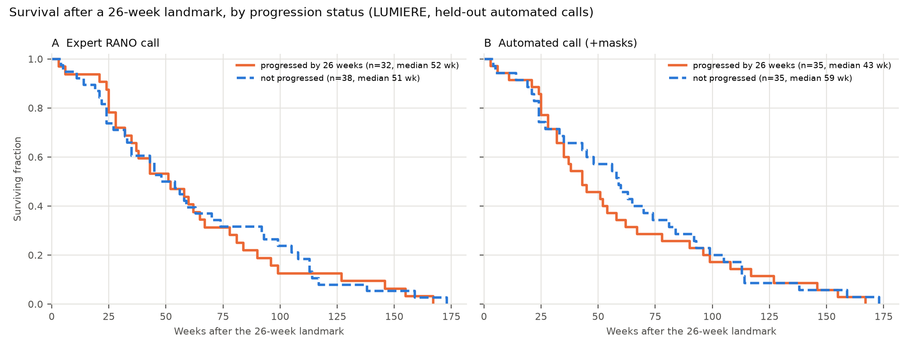

# Next-visit forecasting versus automated progression assessment in glioblastoma: a leakage-free evaluation on LUMIERE

**Draft. All numbers are reproduced by the scripts named in [EXPERIMENTS.md](EXPERIMENTS.md).**

## Abstract

**Background.** Deep models that forecast a glioblastoma's next MRI are usually compared
with "persistence" (copying the last scan), and modest gains over it are reported as
evidence of learned tumor dynamics. We asked two questions on a public longitudinal
dataset:
1. how much of such a gain survives a strict evaluation;
2. whether the same data support a different task: assessing progression on the scan
   that was just acquired.

**Methods.** LUMIERE: 79 patients, 399 scan-to-scan transitions after excluding
pre-operative scans and forecasts across surgery. Every analysis uses patient-level
cross-validation and patient-level bootstrap CIs.
* *Part 1, forecasting.* We compared Neural ODE models with persistence and simple controls
  on five next-visit targets: slice intensities, compartment volumes, 3D tumor masks, the
  inter-segmenter agreement of those masks, and the expert RANO rating. We also calibrated
  ranges for the volume forecast.
* *Part 2, assessment.* We screened alternative questions. We then built an automated
  progression call: whether an expert would rate the current scan as progressive disease
  (PD). Its inputs are automated volumes, the previous rating, clinical factors, and new
  tumor found by comparing the current and previous segmentations. It was trained and
  tested on 374 rated follow-ups. We tested a fully automated version of the call against
  overall survival in 73 patients.

**Results.**
* **Forecasting.** No Neural ODE model beats the best simple comparator.
  * The intensity model's whole-slice gain over persistence, 8.7% [5.7, 11.7], vanishes in
    the tumor region (2.5% [-1.0, 6.0]), where a 1-pixel blur of the last scan does as well.
  * Volume forecasts improve on persistence by 5-7%, much of it population mean reversion.
  * After registration, 3D masks match copy-last-mask (whole-tumor Dice 0.573 vs 0.570).
  * The last RANO rating predicts the next one (AUROC 0.684) as well as any learned model.
  * Calibrated 80/90/95% volume ranges held 80/89/95% of next-visit volumes. Centred on the
    model, they score 16% better than ranges around the last scan.
* **Assessment.** The automated progression call scores AUROC 0.835 [0.796, 0.871].
  Carrying the previous rating forward scores 0.684 (difference +0.151 [+0.093, +0.212]).
  For new progression the call scores 0.760, against 0.649 for an enhancing-volume rule.
  A post-radiotherapy flag in the dataset's rating file would raise AUROC to 0.86, but it
  is annotated selectively and leaks the label.
* **Survival.** The fully automated call is as prognostic as the expert's: time-dependent
  C-index 0.530-0.544 vs 0.539. In this cohort both are weak. A simple volumetric rule did
  better than the expert: 0.607, +0.068 [+0.008, +0.132].

**Conclusion.** On LUMIERE, carrying the last observation forward is close to the best
next-visit forecast. Reading the current scan's status, however, is feasible from
automated measurements: the call approaches an expert reading and is as prognostic as one.
Forecasting claims should be checked against held-out patients, registration and a
smoothing control. Dataset annotations should be audited for label leakage before they
are used as inputs.

## 1. Introduction

Forecasting how a glioblastoma will look at the next visit would help response assessment
and treatment planning, and several deep-learning approaches model it as a continuous-time
dynamical system. Because the tumor and the surrounding brain change slowly relative to
typical imaging intervals, persistence is a strong baseline. A small improvement over it
can therefore come from sources other than tumor dynamics:
* scoring on training data;
* misalignment between visits that a model learns to undo;
* the generic benefit of predicting a smoothed image under squared error;
* label noise that caps attainable accuracy.

This project began with a 2D Attention U-Net + Neural ODE intensity forecaster reported at
+6.7% MSE over persistence across 81 per-patient runs. On inspection, every run had been
scored on its own training pairs. We re-tested that claim and then asked the same question
of progressively more clinically meaningful targets, each time including the controls
needed to read the result.

What drives change between glioblastoma visits is mostly treatment, including radiation,
chemotherapy cycles, second-line drugs and steroids, and LUMIERE does not record it.
Response assessment does not depend on that missing information: whether the current scan
shows progression is visible in the current scan and its predecessors. Automated volumetric
response assessment has been proposed before. It was reported to be a better surrogate for
overall survival than central RANO reading [2]. Once the forecasting results were clear, we
therefore screened which questions LUMIERE can answer under the same rules. We then
developed the one with real signal: an automated, RANO-style progression call. Finally, we
asked whether that call carries the same survival information as the expert's.

## 2. Data and cohort

* **Dataset.** LUMIERE (v202211) [1]: longitudinal FLAIR, T1, T2 and contrast-enhanced T1,
  with DeepBraTumIA and HD-GLIO-AUTO segmentations, expert RANO ratings [3] with a stated
  rationale, and survival times.
* **Visit resolution.** Several visits share a week number (pre-/post-operative and
  re-resection scans). We resolve these deterministically to the latest complete scan of the
  week.
* **Cohort rules** (`lumiere_cohort.py`):
  * Pre-operative scans are dropped (39).
  * A transition never crosses surgery: a post-operative scan starts a new segment, and the
    31 post-operative targets are excluded.
  * History is the earlier scans of the same segment.
* **Result:** 79 patients and 399 transitions. The exclusion log is in
  `results/volume_trajectory/metrics.md`.
* **Rated follow-ups:** 374 of the 399 targets have an expert rating of PD, SD, PR or CR
  (63% PD). In 238 of them the previous scan was not PD (50% PD).
* **Survival:** known for 86 of 91 LUMIERE patients. Of the 79 cohort patients, 76 have a
  recorded survival time. 3 of these are excluded because their recorded death precedes
  their last scan, leaving 73.
* **Folds.** Patient-level 5-fold assignment with seed 0, shared by all experiments. The
  volume, RANO, interval, screen and progression-call experiments add fold seeds 1 and 2.
  Inner validation splits differ between experiments.
* **Reporting.** Differences are reported as the mean over patients of the per-patient
  difference, with 95% bootstrap CIs over patients.

## 3. Methods

### 3.1 Alignment between visits

Step 2 was first run in LUMIERE's per-scan DeepBraTumIA atlas space, on the assumption
that it makes visits voxel-aligned. We tested this assumption (`alignment_check.py`) by
correlating healthy tissue between the last scan and the target. Healthy tissue here means
the brain eroded by 2 mm, minus both tumors dilated by 5 mm.

Atlas-space alignment is poor:
* median T1 correlation 0.57;
* median estimated shift 2.5 mm (Figure 1);
* a dedicated affine registration reaches 0.85.

We therefore registered each target, and the second-to-last scan, into the frame of the
**last** scan (`register_step2_pairs.py`, 691 pairs):
* one rigid-then-affine transform per pair on T1, Mattes mutual information;
* tumors masked out of the metric;
* the transform applied to all modalities and the segmentation;
* brain-overlap QC with fallbacks.

Because the forecast is made from the last scan, the inputs carry no target information.
After registration, median healthy-tissue T1 correlation is 0.85 and brain Dice is 0.981.

*Figure 1. Alignment of the last scan to the target in healthy tissue: LUMIERE atlas space
vs affine registration, 399 transitions.*

### 3.2 Part 1: forecasting experiments

**A. Original intensity model, held-out retest** (`intensity_forecast_cv.py`). The
original model and metric are kept: 5 centre slices × 4 modalities, history registered to
the target, zero-initialised warp and residual heads. Only the evaluation changes:
* patient-level CV;
* the checkpoint is chosen on held-out training patients.

Controls:
* tumor-region ("focal") MSE;
* a blurred-persistence baseline, with the Gaussian width tuned on training patients only.

**B. Volume trajectory** (`volume_trajectory_experiment.py`). Targets are log1p(mL) of
necrosis, enhancing tumor and edema at the next visit. Methods:
* persistence;
* per-patient log-linear extrapolation;
* population Gompertz;
* ridge regression and gradient boosting on history features;
* an ODE-RNN (GRU updates at scans, latent ODE between them, zero-initialised residual
  decoder), as a 5-seed ensemble.

**C. 3D mask forecast** (`mask_forecast_experiment.py`).
* Input: 2 mm volumes. The last scan (4 modalities + WT/TC/ET masks), the previous scan's
  masks and gap when available, and the interval.
* Model: a 3D U-Net whose bottleneck is evolved either by a Neural ODE over the interval or
  by an additive interval embedding (ablation). It predicts a displacement field that warps
  the last mask plus residual logits. Both heads are zero-initialised, so the untrained
  model is exactly persistence.
* Selection: the checkpoint with the best validation-patient Dice over a fixed 40 epochs,
  with the persistence initialisation as a candidate. Patient folds as in B (seed 0).
* Metrics: Dice, and change-Dice (overlap of predicted and real change relative to the last
  mask).
* Frames: run in both the atlas frame and the registered frame.

**D. Inter-segmenter agreement and stratification** (`step2_followup_analysis.py`).
* (a) Same-scan agreement between DeepBraTumIA, the step-2 label, and HD-GLIO-AUTO on all
  399 target scans. HD-GLIO is mapped by registering its own CT1 to DeepBraTumIA's atlas
  CT1, with 4 starting orientations and no tumor masks used; brain-mask Dice median 0.978.
  LUMIERE's HD-GLIO native-space files are mis-oriented for many scans, so they were not
  used.
* (b) Copy-last-mask Dice on visits the expert rated stable disease.
* (c) Step 2 results split by RANO rating, volume change, overlap change and interval.

**E. Next-visit RANO rating** (`rano_forecast_experiment.py`). The task is PD vs SD/PR/CR
on 374 rated transitions. Features use only information known at the last scan:
* volume history, including height above the nadir;
* the interval;
* the last visit's rating;
* age, sex and MGMT.

Comparators:
* trivial rules: last volume, interval, last rating;
* logistic regression and gradient boosting;
* the step-B forecasts.

**F. Calibrated ranges for the volume forecast** (`volume_intervals.py`). We used
normalized split-conformal prediction [4] around the step-B gradient-boosting forecast:
* Residuals in log1p(mL) come from patient-grouped out-of-fold forecasts.
* A log-link Poisson GLM predicts residual size from the horizon, the last volume, a
  zero-volume flag and a single-scan-history flag.
* Equal-tailed conformal quantiles of the scaled residuals give the 50/80/90/95% ranges.

Evaluation is nested: the calibration is refit inside each outer training split. The
comparators are ranges centred on the last scan, with fixed or scaled width. Scoring uses
coverage and the interval score [5].

### 3.3 Part 2: assessment experiments

**G. Screen of alternative questions** (`approach_screen.py`). Three tasks, each against
its own trivial rule and under the fold rules above:
1. volume at *any* later scan of the segment (1,473 pairs), scored by horizon, against
   copy-last, a horizon-only drift model and population Gompertz;
2. whether the current scan is PD;
3. remaining survival from each visit (73 patients, 454 visits), scored by C-index over
   pairs of visits from different patients. The comparator uses age, sex, MGMT, time since
   the first scan and the number of surgeries.

**H. Automated progression call** (`progression_call_experiment.py`; released as
`progression_model.py`). Rows are the 374 expert-rated follow-ups; the label is PD. Inputs
are restricted to what a reader has when the scan is taken:
* **V**: the current scan's automated volumes, their change since the previous scan and
  since the segment nadir, and timing;
* **R**: the previous scan's expert rating;
* **S**: age, sex and MGMT;
* **M**: comparison of the current with the previous segmentation. It measures new
  enhancing tumor outside the dilated prior tumor core, new FLAIR abnormality, new
  enhancing components and the largest axial enhancing area, a stand-in for RANO's 2D
  measurement.
  * The released version works directly in atlas space with an 8 mm margin, which absorbs
    the ~2.5 mm misalignment (3.1), so no registration is needed. We chose 8 mm among
    4/6/8 mm.
  * A registered-frame version with a 4 mm margin is the reference.

The models are gradient-boosted trees with monotone constraints, so more growth or more new
tumor never lowers the PD probability. "Fully automated" variants omit R and S.
Comparators: the previous rating carried forward; enhancing-volume change since the nadir;
new enhancing volume. Two operating thresholds come from out-of-fold probabilities: 80%
specificity ("likely PD") and 90% sensitivity (below it, "PD less likely").

**I. Survival validation** (`progression_survival.py`). This covers the 73 patients with
usable survival. Progression is the first follow-up of the first surgery-free segment
called PD, made in one of three ways:
* by the expert;
* by the fully automated call, using the held-out probability with a threshold of 0.5
  (pre-specified) or one matched to the expert's number of progressions;
* by a volumetric rule: enhancing tumor ≥ 40% above the segment nadir and ≥ 1 mL above it.

A re-operation counts as progression if none was called before. Progression enters a
Breslow Cox model as a time-varying covariate. We also report a time-dependent C-index,
landmark analyses at 26 and 52 weeks, and 2,000 patient-bootstrap resamples. Survival is
never used for model fitting.

## 4. Results

### 4.1 The original claim on held-out patients (A)

| metric | model vs persistence [95% CI] | patients better | 1-px blurred persistence | model minus blur [95% CI] |
| :--- | :---: | ---: | :---: | :---: |
| whole-slice MSE (original metric) | +8.7% [+5.7, +11.7] | 64/79 | +3.7% | +5.0% [+2.1, +8.0] |
| tumor-region MSE | +2.5% [-1.0, +6.0] | 50/79 | +4.1% | -1.6% [-5.1, +2.0] |
| whole-slice MAE | +5.4% [+3.6, +7.2] | 64/79 | -1.2% | +6.7% [+4.8, +8.5] |

The headline number is reproduced on unseen patients. Two things show it is not tumor
forecasting:
* inside the tumor region the gain is indistinguishable from zero and below a blur of the
  last scan;
* the remaining whole-slice gain over blur is outside the tumor, consistent with global
  intensity and normalisation correction.

T1 MSE gets worse (-9.9%).

### 4.2 Volume (B)

| method | MAE, log1p(mL) | vs persistence | patient diff [95% CI] | AUROC, next-visit PD |
| :--- | ---: | ---: | :---: | ---: |
| persistence | 0.745 | - | - | 0.500 |
| log-linear extrapolation | 0.993 | -33.4% | +0.219 [+0.164, +0.277] | 0.541 |
| Gompertz (population) | 0.719 | +3.4% | -0.076 [-0.114, -0.038] | 0.584 |
| ridge | 0.721 | +3.2% | -0.088 [-0.136, -0.040] | 0.653 |
| gradient boosting | 0.693 | +6.9% | -0.085 [-0.119, -0.051] | 0.635 |
| Neural ODE (ODE-RNN) | 0.708 | +4.9% | -0.081 [-0.122, -0.044] | 0.628 |

Learned models reduce volume error significantly, but by a few percent, and much of it is
mean reversion captured by a two-parameter population model. Per-patient exponential
extrapolation is far worse than persistence. Direct paired comparisons do not establish ODE
superiority over the tabular models, or equivalence to them.

*Figure 2. Next-visit volume error relative to persistence (95% CI over patients).*

### 4.3 3D masks (C)

| frame | variant | WT Dice, model / persistence | TC | ET | Dice diff [95% CI] | change-Dice diff [95% CI] |
| :--- | :--- | :---: | :---: | :---: | :---: | :---: |
| atlas | Neural ODE | 0.521 / 0.506 | 0.355 / 0.350 | 0.231 / 0.234 | +0.010 [+0.000, +0.019] | +0.127 [+0.107, +0.148] |
| atlas | interval embedding | 0.521 / 0.506 | 0.360 / 0.350 | 0.239 / 0.234 | +0.011 [+0.005, +0.017] | +0.118 [+0.101, +0.135] |
| registered | Neural ODE | 0.573 / 0.570 | 0.408 / 0.406 | 0.266 / 0.278 | +0.003 [-0.003, +0.010] | +0.071 [+0.053, +0.092] |
| registered | interval embedding | 0.574 / 0.570 | 0.408 / 0.406 | 0.277 / 0.278 | +0.006 [+0.001, +0.012] | +0.076 [+0.058, +0.093] |

Registration alone raises persistence Dice more than either model does: 0.506 → 0.570.
The change-Dice gain is smaller after registration. But registration changes both the
trained models and the references, so this cannot identify a causal fraction due to
misalignment. In the registered frame:
* the Neural ODE matches persistence on whole tumor and is slightly below it on enhancing
  tumor;
* validation checkpoint selection kept persistence in folds 0 and 4 for both variants;
* direct paired mean-Dice comparisons do not establish an ODE advantage; secondary
  endpoints differ.

*Figure 3. Next-visit mask Dice, model vs persistence, atlas frame (top) and registered
frame (bottom).*

*Figure 4. Registered-frame forecasts for held-out patients. These are fold 0 last-epoch
weights, which show what the network learned; the validation-selected fold-0 model used
for the metrics is persistence. Panels: last scan with its outline, real next scan,
forecast vs real outline, and change map.*

### 4.4 Inter-segmenter agreement and where the mask model helps (D)

| comparison | whole-tumor Dice |
| :--- | :---: |
| DeepBraTumIA vs HD-GLIO on the same scan (patient mean [95% CI]) | 0.648 [0.612, 0.680] |
| same, excluding DeepBraTumIA's necrosis/cavity label | 0.689 [0.655, 0.721] |
| copy-last-mask, visits rated stable, ≤ 12 weeks apart (mean, n=32) | 0.581 |
| copy-last-mask, all transitions (mean) | 0.570 |

Same-scan inter-segmenter agreement is not a forecasting accuracy bound. Label
conventions, correlated errors, real interval change and registration differences
prevent converting the gap above persistence into attainable headroom. Stable-visit
differences cannot all be attributed to measurement noise.

Stratified (Figure 5), the mask models behave like a population growth prior:
* They enlarge the tumor in 78-82% of transitions where the forecast differs from the last
  mask; 53% actually grew. This includes tumors that later shrank by more than 20%.
* They gain slightly where tumors grew (+0.009 to +0.019 Dice) and lose where nothing
  changed (-0.014) and under complete response (-0.03).
* Their correlation with the true volume change (+0.38 to +0.46) is matched by the last
  volume alone ("small tumors grow"; +0.47 to +0.48). After removing it, the correlation
  is +0.08 to +0.11.

*Figure 5. Registered-frame gain over copy-last-mask by RANO rating, volume change, overlap
with the last mask, and interval.*

### 4.5 Next-visit RANO rating (E)

| score | AUROC [95% CI] | minus last-rating rule [95% CI] |
| :--- | :---: | :---: |
| last volume ("small tumor grows") | 0.565 [0.491, 0.642] | -0.118 [-0.207, -0.026] |
| last visit's rating | 0.684 [0.621, 0.740] | - |
| logistic, volumes + timing + clinical | 0.593 [0.530, 0.657] | -0.090 [-0.158, -0.020] |
| logistic, all features | 0.686 [0.620, 0.747] | +0.002 [-0.042, +0.053] |
| gradient boosting, all features | 0.723 [0.660, 0.781] | +0.040 [-0.015, +0.092] |
| step 1 Neural ODE, predicted volume change | 0.633 [0.563, 0.708] | -0.051 [-0.133, +0.037] |

A patient rated PD is rated PD at the next visit 87% of the time. That rule is as strong as
any learned model, and as well calibrated: Brier 0.201 vs 0.204 for gradient boosting, and
0.233 for always predicting the base rate.

The clinically useful case is predicting new progression in a patient currently not
progressing (238 transitions, 50% PD). There, every score has AUROC ≤ 0.61 and none is
distinguishable from the last-volume rule.

*Figure 6. AUROC for next-visit RANO progression: trivial rules, models trained on the
label, and step 1 volume forecasts.*

### 4.6 Calibrated ranges for the volume forecast (F)

Held-out results for total tumor volume at the 80% level:

| range | coverage | patient-averaged coverage [95% CI] | mean width, log1p(mL) | interval score |
| :--- | ---: | :---: | ---: | ---: |
| last scan, fixed width | 0.802 | 0.757 [0.690, 0.819] | 2.067 | 3.561 |
| last scan, scaled width | 0.805 | 0.776 [0.722, 0.828] | 2.064 | 3.370 |
| GBM forecast, fixed width | 0.799 | 0.751 [0.687, 0.811] | 1.735 | 3.069 |
| **GBM forecast, scaled width** | **0.800** | **0.791 [0.739, 0.839]** | **1.668** | **2.916** |

* **Coverage.** The deployed ranges held their stated coverage: 80% → 0.80, 90% → 0.89,
  95% → 0.95. The 50% range held 0.52 of visits but 0.45 averaged over patients.
* **Sharpness.** Centred on the model, the ranges score 16% better than equally calibrated
  ranges around the last scan (CI excludes 0) and are 19% narrower at 80%. This is the
  clearest evidence that the volume model adds information, and it is larger than its 5-7%
  point-error gain.
* **Scaled vs fixed width.** Scaling leaves average sharpness unchanged but keeps coverage
  across subgroups. With a fixed width, 80% ranges covered 64% of single-scan histories and
  57% of horizons beyond 26 weeks; scaled, they covered 79% and 70%.
* **Width.** The ranges are wide: a typical 80% range spans ×0.53 to ×2.1 of the forecast.
* **Direction calls.** When an 80% range excluded "no change" (about 7% of visits), the
  tumor moved in the called direction 84% (growth) and 93% (shrinkage) of the time. The base
  rates are 55% and 44%.

*Figure 7. Held-out coverage of the volume ranges against nominal (A), and 80% coverage
(B) and width (C) by horizon.*

### 4.7 Which questions the data can answer (G)

| question | best model | its trivial rule | difference [95% CI] |
| :--- | :--- | :--- | :---: |
| volume 27-52 / > 52 weeks ahead (MAE skill vs copy-last) | GBM +14.5% / +16.4% | population Gompertz | +0.002 [-0.038, +0.040] / -0.032 [-0.108, +0.041] log1p(mL) |
| is the current scan PD? (AUROC) | 0.821 | previous rating: 0.684 | +0.137 [+0.070, +0.209] |
| remaining survival from each visit (C-index) | 0.678 | clinical + time: 0.599 | +0.078 [+0.022, +0.131] |

* **Long-horizon volume.** Error against copy-last improves with horizon (4.6% at ≤ 13
  weeks, 16.4% beyond a year). A two-parameter Gompertz model captures all of it: patient
  history adds nothing beyond mean reversion. Per-patient slope extrapolation is far worse
  than copy-last.
* **Prognosis.** This shows modest signal.
* **Current-scan assessment.** This is the only large, clean gain, so we developed it (4.8).

### 4.8 Automated progression call (H)

| score | AUROC [95% CI] | minus previous rating [95% CI] | AUROC, previous scan not PD |
| :--- | :---: | :---: | :---: |
| previous rating carried forward | 0.684 [0.622, 0.738] | - | 0.523 |
| rule: enhancing volume change vs nadir | 0.711 [0.649, 0.772] | +0.027 [-0.059, +0.116] | 0.649 |
| rule: new enhancing volume (atlas, 8 mm) | 0.713 [0.648, 0.775] | +0.030 [-0.061, +0.117] | 0.699 |
| fully automated: volumes (V) | 0.785 [0.734, 0.835] | +0.101 [+0.030, +0.176] | 0.734 |
| fully automated: volumes + masks (V+M) | 0.797 [0.753, 0.841] | +0.113 [+0.045, +0.184] | 0.756 |
| released: volumes + rating + clinical (V+R+S) | 0.820 [0.774, 0.862] | +0.136 [+0.072, +0.203] | 0.728 |
| **released: + masks (V+R+S+M, atlas, 8 mm)** | **0.835 [0.796, 0.871]** | **+0.151 [+0.093, +0.212]** | **0.760** |
| reference: + masks (registered, 4 mm) | 0.838 [0.797, 0.873] | +0.154 [+0.093, +0.217] | 0.762 |

* **Accuracy.** The call substantially exceeds carrying the previous rating forward, and
  for new progression it exceeds the volumetric rules.
  * The mask features add +0.015 [-0.002, +0.032] overall. At 80% specificity they find 73%
    of PD scans rather than 69%, and the gain is concentrated in new progression (0.760 vs
    0.728).
  * Atlas-space masks lose almost nothing against registration (0.835 vs 0.838). The 8 mm
    margin was chosen among three, so the atlas figure carries a little selection
    optimism.
* **Calibration.** Brier scores are 0.162 with masks and 0.168 without, against 0.201 for
  the previous rating and 0.233 for a constant. Monotone constraints cost nothing:
  unconstrained V+R+S scores 0.821.
* **Bands.** On held-out patients, with masks:
  * "likely PD": 53% of scans, 86% of them rated PD;
  * "uncertain": 26%, 41% PD;
  * "PD less likely": 20%, 32% PD.
* **What is missed.** PD called for T2 progression alone (18 scans) is mostly missed: 39%
  are found. Near-stable scans after a non-PD rating are over-called: across 28 scans, 25%
  were rated PD, but the mean probability is 0.44 with masks (0.48 without). Two of them
  cross the "likely PD" threshold with masks, none without.
* **An annotation that leaks the label.** The rating file's `LessThan3Months` flag marks
  scans within three months of radiotherapy, where RANO does not allow a PD call on
  enhancement growth alone. Adding it raised AUROC to 0.86. But it is annotated
  selectively:
  * of 78 rated first follow-ups 9-26 weeks after surgery, only 16 carry it;
  * flagged scans had grown (median enhancing log-change vs nadir +0.48) and unflagged
    early scans had not (-0.03).
  The flag records the rater's decision not to call growth PD, so we excluded it.

*Figure 8. Held-out ROC curves of the progression call on all rated follow-ups (A) and on
scans whose previous rating was not PD (B).*

### 4.9 Does the automated call predict survival like the expert's? (I)

| progression called by | patients | median weeks start → call | median weeks call → death | HR for death after progression [95% CI] | time-dependent C-index [95% CI] | C minus expert [95% CI] |
| :--- | ---: | ---: | ---: | :---: | :---: | :---: |
| expert | 67 | 27 | 48 | 2.14 [0.80, 10.04] | 0.539 [0.484, 0.590] | - |
| volumetric rule | 67 | 23 | 45 | 3.91 [1.90, 13.10] | 0.607 [0.549, 0.662] | +0.068 [+0.008, +0.132] |
| fully automated, V+M, p ≥ 0.5 | 66 | 25 | 50 | 1.68 [0.77, 4.92] | 0.530 [0.481, 0.583] | -0.009 [-0.066, +0.050] |
| fully automated, V, p ≥ 0.5 | 67 | 25 | 49 | 2.03 [0.85, 8.60] | 0.544 [0.492, 0.599] | +0.006 [-0.038, +0.056] |

* **Automated vs expert.** The fully automated call is as prognostic as the expert's.
  Rate-matched thresholds give the same result (C-index 0.522 and 0.541).
* **Timing.** The calls coincide in timing. Of 65 patients who progressed under both, 34
  were called on the same scan, 16 earlier and 15 later (median difference 0 weeks).
  Progression status at 26 weeks agreed for 79% of patients (kappa 0.57).
* **Both are weak markers.** The expert's C-index CI includes 0.5. No definition separates
  survival significantly at the 26- or 52-week landmarks (70 and 53 patients alive; HRs
  1.06-1.82, all CIs include 1). Nearly every patient progresses (67 of 73), so "has
  progressed" says little about who dies sooner (Figure 9).
* **The volumetric rule.** It is more prognostic than the expert while calling progression
  *earlier* (median 23 vs 27 weeks after the segment start). So its higher HR is not an
  artifact of late calls. It is one of several comparisons and its lower bound is near 0.

*Figure 9. Survival after a 26-week landmark by progression status: expert call (A) and
fully automated call (B).*

## 5. Discussion

The two halves of this study point the same way. LUMIERE holds enough information to read
a scan's current status. It does not hold enough to forecast the next one.

**Forecasting.** The Neural ODE formulation, in three settings (2D intensity, 3D mask,
volume trajectory), does not beat the best simple comparator once each confound is removed.

What inflated the original result:
* Scoring on training pairs. This turned out to be minor: the gain survives on held-out
  patients.
* Smoothing. An MSE-trained forecaster under uncertainty benefits from blurring, and a
  tuned blur of the last scan explains the tumor-region gain.
* Global intensity correction outside the tumor.

What inflated the first mask result:
* Misalignment between visits in a space that was assumed to be aligned.

Why there is little left to find:
* Automated tumor masks of the same scan agree only to Dice 0.65.
* Stable visits overlap at 0.58.
* Expert RANO ratings are highly persistent.
* The main driver of change, treatment, is not recorded.

The volume model's value shows most clearly in its uncertainty, not its point forecast:
calibrated ranges centred on it are 16% sharper than ranges around the last scan.

**Assessment.** The automated progression call works because its target is observable. The
current scan and its predecessors carry the growth, the new lesions and the timing that a
reader uses. With automated measurements alone, the call reaches AUROC 0.835. For new
progression it reaches 0.760, the case where carrying the previous rating forward is
useless (0.523).

Its remaining errors are the ones expected from volumetry:
* subtle T2/FLAIR progression;
* stable scans that a reader called PD for reasons not visible in volumes.

Monotone constraints make its behavior predictable: more growth never lowers the
probability. Its bands report their own held-out accuracy.

**Survival.** A model trained to reproduce expert readings inherits the expert's
prognostic value, and here that value is small. The volumetric rule did better, which
agrees with the report that automated volumetric response assessment is a better survival
surrogate than RANO reading [2]. If the goal is an endpoint for trials, a progression
definition built for survival is a better target than imitating the reader. That
definition could be the volumetric rule itself or a model trained on survival.

**Leakage in annotations.** The `LessThan3Months` flag looked like legitimate clinical
timing information. It was in fact recorded mostly when it changed the reader's decision.
Fields in a rating file can encode the rating, and they should be checked before use.

**Practical recommendations:**
1. Report persistence and a tuned blurred-persistence control.
2. Register the target into the input frame and quantify the residual misalignment.
3. Report same-scan inter-segmenter agreement without interpreting it as an accuracy bound.
4. Report stratified results (growing, stable and responding tumors), because a growth prior
   looks like skill in pooled metrics.
5. Before forecasting, check whether the dataset supports a different, observable target.
   Screen alternatives under the same rules.
6. Audit every annotation used as an input for selective recording that correlates with the
   label.

**Limitations:**
* Single centre, 79 patients, and no external validation.
* Labels are automated (DeepBraTumIA), apart from the RANO ratings. The progression label
  is one expert reading per scan, and inter-reader variability is not captured.
* The forecasting models are deliberately conservative (zero-initialised at persistence)
  and trained for a fixed budget. Larger models or pretraining might extract more.
* The progression call's mask margin was chosen among three on the same cross-validation.
  Its released thresholds come from out-of-fold predictions, not an independent set.
* The survival analysis assumes LUMIERE's survival times share the scan-week origin. It
  excludes 3 patients, and its landmark analyses are underpowered.
* Same-segmenter test-retest data would help characterize measurement repeatability.

## 6. Conclusion

On LUMIERE, carrying the last scan, mask or rating forward is close to the best available
next-visit forecast. Paired comparisons do not establish ODE superiority over static
comparators, and exploratory secondary effects vary by endpoint.

The same data support automated assessment of the current scan. A volumetric progression
call reaches AUROC 0.835 against the expert reading and is as prognostic as the reading
itself. A simple volumetric rule is the more prognostic definition of progression and
merits external validation.

The evaluation protocol, its controls, and the released tools (`scripts/predict.py`;
PREDICTION.md) are the main contribution.

## References

1. Suter Y, et al. The LUMIERE dataset: longitudinal glioblastoma MRI with expert RANO
   evaluation. *Sci Data.* 2022;9:768.
2. Kickingereder P, et al. Automated quantitative tumour response assessment of MRI in
   neuro-oncology with artificial neural networks: a multicentre, retrospective study.
   *Lancet Oncol.* 2019;20(5):728-740.
3. Wen PY, et al. Updated response assessment criteria for high-grade gliomas: Response
   Assessment in Neuro-Oncology Working Group. *J Clin Oncol.* 2010;28(11):1963-1972.
4. Lei J, G'Sell M, Rinaldo A, Tibshirani RJ, Wasserman L. Distribution-free predictive
   inference for regression. *J Am Stat Assoc.* 2018;113(523):1094-1111.
5. Gneiting T, Raftery AE. Strictly proper scoring rules, prediction, and estimation.
   *J Am Stat Assoc.* 2007;102(477):359-378.

## Data and code availability

* LUMIERE is available from its authors under their data-use terms. It is not
  redistributed; see `DATA_SETUP.md`.
* All code, derived result tables and figures are in this repository. EXPERIMENTS.md gives
  every command.
* The released models run with `scripts/predict.py` (PREDICTION.md). They are research
  tools without clinical validation.

---
**Status**: draft
**Updated**: November 4, 2026

## Release audit (2026-11-03; applies to Part 1 and supersedes unpaired interpretations there)

See RELEASE_AUDIT.md and results/release_audit/effects.md for direct paired effects.
ODE-minus-ridge volume MAE is +0.0079 log1p(mL) (95% CI -0.0137 to +0.0290),
and ODE-minus-GBM is +0.0040 (-0.0122 to +0.0190). Mean mask Dice differences
versus static are -0.0019 (-0.0078 to +0.0041) atlas and -0.0031
(-0.0080 to +0.0013) registered. Neither superiority nor equivalence is established.
The volume experiment has three outer assignments; masks match repeat 0 only;
inner validation splits differ. No matched neural no-ODE volume model exists.
All 798 cached reference checks match, but four CPU checkpoint replays differ
slightly from historical tables. Historical volume estimator states are missing.
New all-cohort GBM weights are a refit, with no held-out estimate for those weights;
mask release ensembles combine existing CV models and have no independent ensemble
accuracy estimate. These are research artifacts, without clinical validation.
